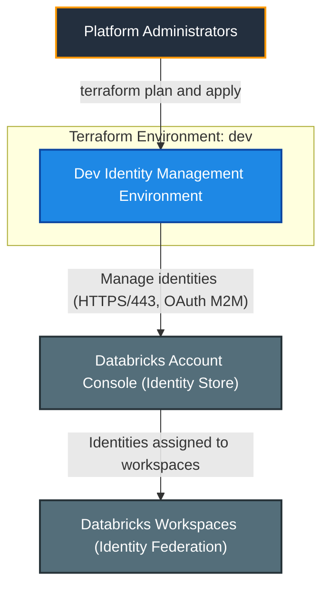
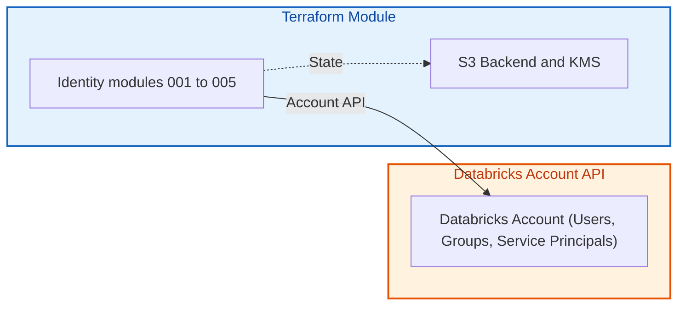
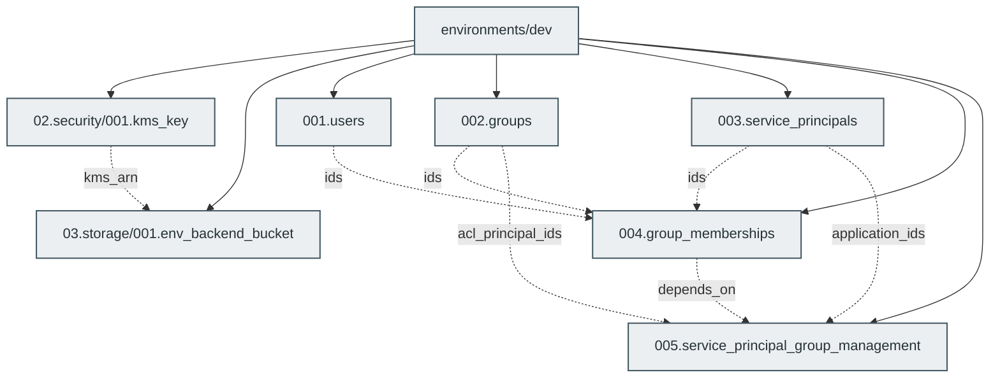

# Enterprise Databricks Identity Management

[](https://developer.hashicorp.com/terraform/docs)
[](https://registry.terraform.io/providers/databricks/databricks/latest/docs)
[](https://docs.databricks.com/aws/en/admin/users-groups/)
[](file:///.github/README.md)

---

## 1. Executive Summary

- **Purpose & Scope**:
  Terraform repository that manages the Databricks **account-level identity model** on AWS: users, groups, service principals, group memberships and group-level service principal management, plus the encrypted S3 state backend. Only the `dev` environment is configured.
- **Problem Statement & Solution**:
  Identity sprawl and manual console changes make access hard to audit. This environment defines the whole identity model as code, so every change is peer-reviewed and reproducible.
- **Key Business & Security Outcomes**:
  - **Single source of configuration**: `locals.tf` holds strings, maps and lists for all identities.
  - **Group-centric access**: Users and service principals receive access via groups; service principals are managed by groups.
  - **Encrypted state**: State is stored in a versioned, KMS-encrypted S3 bucket.
  - **Modular architecture**: Five reusable identity modules plus KMS and backend modules.

---

## 2. General Logic & Operational Flow

### 2.1 Configuration & Provisioning Lifecycle
1. **Locals**: `locals.tf` defines `users` (parameterized by user email variables), `groups` (with optional `account_admin`), `service_principals`, `group_memberships` and `service_principal_group_roles`.
2. **Sequencing**: KMS key -> backend bucket; users, groups and service principals -> memberships -> service principal rule sets (strictly sequenced via `depends_on`).
3. **Quality Engineering & Toolchain**:
   - **Pre-commit Automation**: Code hygiene, formatting (`terraform fmt`), module/environment validation (`terraform validate`), and interface docs (`terraform-docs`).
   - **Linting & Best Practices**: `tflint` configured with the official Terraform ruleset and AWS plugin (for remote state and KMS).
   - **Security & Secret Scanning**: `gitleaks` (detects accidental commits of Databricks OAuth client secrets) and `trivy` (IaC scanning for High/Critical vulnerabilities).
   - **Streamlined Scope**: Pruned heavyweight VPC networking rules and redundant scanners (e.g. Checkov) to ensure fast, reliable CI checks focused on Databricks identity SCIM resources.
4. **Validation**: Run `pre-commit run --all-files`, `terraform validate`, and `terraform plan` from `environments/dev`. Never apply without explicit approval.

### 2.2 Identity & Data Flow
- **Auth**: account-level `databricks.mws` provider using an OAuth M2M service principal (`service_principal_id` / `service_principal_secret`) and `databricks_account_id`.
- **Data flow**: module outputs (IDs, application IDs, ACL principal IDs) are wired in `main.tf`.

---

## 3. Architecture of the Repository

### 3.1 Resource Architecture & Attributes

| Locals key | Type | Purpose |
|:---|:---:|:---|
| `users` | `map(object)` | Account users (`user1`, `user2`) parameterized via email variables |
| `groups` | `map(object)` | Account groups (`platform_admins` with `account_admin = true`, `data_engineers`, `data_scientists`, `data_analysts`) |
| `service_principals` | `map(object)` | Account service principals (`terraform_automation`, `etl_pipelines`, `data_science`) |
| `group_memberships` | `map(object(lists))` | Group => users / service principals / groups |
| `service_principal_group_roles` | `map(object)` | Service principal => `managers` / `users` groups |

### 3.2 Reference Usage
Module layout:

```text
modules/
  02.security/001.kms_key
  03.storage/001.env_backend_bucket
  04.identity_management/
    001.users
    002.groups
    003.service_principals
    004.group_memberships
    005.service_principal_group_management
environments/dev/
```

See [`environments/dev/README.md`](./environments/dev/README.md).

### 3.3 Security, IAM & Encryption Posture
- **State**: KMS-encrypted, versioned S3 backend with lockfile.
- **Secrets**: `terraform.tfvars` is git-ignored; `service_principal_secret` is marked `sensitive = true`; prefer `TF_VAR_*` environment variables in CI.
- **Access**: rule sets are authoritative and sequenced after group memberships to prevent replication race conditions; review plans carefully.

---

## 4. Architecture C4 Visualisation

### 4.1 Level 1: System Context Diagram


### 4.2 Level 2: Container / Infrastructure Diagram


### 4.3 Level 3: Component Diagram (Terraform Resource Orchestration)


---

## 5. All Modules Used with Short Summaries

### 5.1 Module Inventory Table

| Module Name | Source Path | Version / Ref | Primary Role / Responsibility |
|:---|:---|:---:|:---|
| `kms_key` | `modules/02.security/001.kms_key` | `n/a` | KMS key for backend encryption. |
| `backend_bucket` | `modules/03.storage/001.env_backend_bucket` | `n/a` | Encrypted, versioned S3 state bucket. |
| `users` | `modules/04.identity_management/001.users` | `n/a` | Account users. |
| `groups` | `modules/04.identity_management/002.groups` | `n/a` | Account groups. |
| `service_principals` | `modules/04.identity_management/003.service_principals` | `n/a` | Account service principals. |
| `group_memberships` | `modules/04.identity_management/004.group_memberships` | `n/a` | Members of groups. |
| `service_principal_group_management` | `modules/04.identity_management/005.service_principal_group_management` | `n/a` | Group roles on service principals. |

### 5.2 Module READMEs

[`001.kms_key`](modules/02.security/001.kms_key/README.md), [`001.env_backend_bucket`](modules/03.storage/001.env_backend_bucket/README.md), [`001.users`](modules/04.identity_management/001.users/README.md), [`002.groups`](modules/04.identity_management/002.groups/README.md), [`003.service_principals`](modules/04.identity_management/003.service_principals/README.md), [`004.group_memberships`](modules/04.identity_management/004.group_memberships/README.md), [`005.service_principal_group_management`](modules/04.identity_management/005.service_principal_group_management/README.md).

---

## 6. Terraform Documentation Interface

> [!NOTE]
> The full machine-generated Terraform interface (Providers, Modules, Inputs, Outputs, and Resource definitions) is maintained by `terraform-docs` via pre-commit hooks in [`TERRAFORM.md`](./environments/dev/TERRAFORM.md).
>
> Please refer directly to [`TERRAFORM.md`](./environments/dev/TERRAFORM.md) for detailed variable schemas, default values, and data structures.

### 6.1 Essential Inputs Summary

| Variable | Type | Description | Sample Value |
|:---|:---:|:---|:---|
| `aws_account_id` | `string` | Allowed AWS account | `"123456789012"` |
| `databricks_account_id` | `string` | Databricks account UUID | `"00000000-0000-0000-0000-000000000000"` |
| `service_principal_id` | `string` | OAuth client ID of the admin service principal | `"<client-id>"` |
| `service_principal_secret` | `string` | OAuth client secret (sensitive) | `"<secret>"` |
| `user1_email` | `string` | Email address of the first Databricks account user | `"user1@example.com"` |
| `user2_email` | `string` | Email address of the second Databricks account user | `"user2@example.com"` |

### 6.2 Essential Outputs Summary

This environment exposes no outputs; results are visible in the Databricks Account Console.

---

## 7. Important Links and Resources


### 7.1 Authoritative Databricks Documentation
- [Databricks on AWS Official Documentation](https://docs.databricks.com/aws/en/) - Core guide for Databricks on AWS.
- [Manage users, service principals, and groups](https://docs.databricks.com/aws/en/admin/users-groups/) - Identity management concepts for Databricks accounts.
- [Manage groups](https://docs.databricks.com/aws/en/admin/users-groups/groups) - Account groups and membership.
- [Manage service principals](https://docs.databricks.com/aws/en/admin/users-groups/service-principals) - Service principal roles (Manager, User) and management.
- [Databricks Terraform Provider Documentation](https://registry.terraform.io/providers/databricks/databricks/latest/docs) - Terraform registry provider guide for Databricks resources.

### 7.2 Terraform & Tooling Documentation
- [Terraform Language Documentation](https://developer.hashicorp.com/terraform/docs) - HCL syntax, expressions, and configuration concepts.
- [terraform-docs Documentation](https://terraform-docs.io/) - Automated interface generation tool used for [`TERRAFORM.md`](./environments/dev/TERRAFORM.md).

### 7.3 Internal Repository References
- [Project Instructions & Source of Truth](file:///.ai/instructions.md) - Architectural guidelines and coding standards.
- [Authoritative README Template](file:///.ai/README_TEMPLATE.md) - This template specification.
