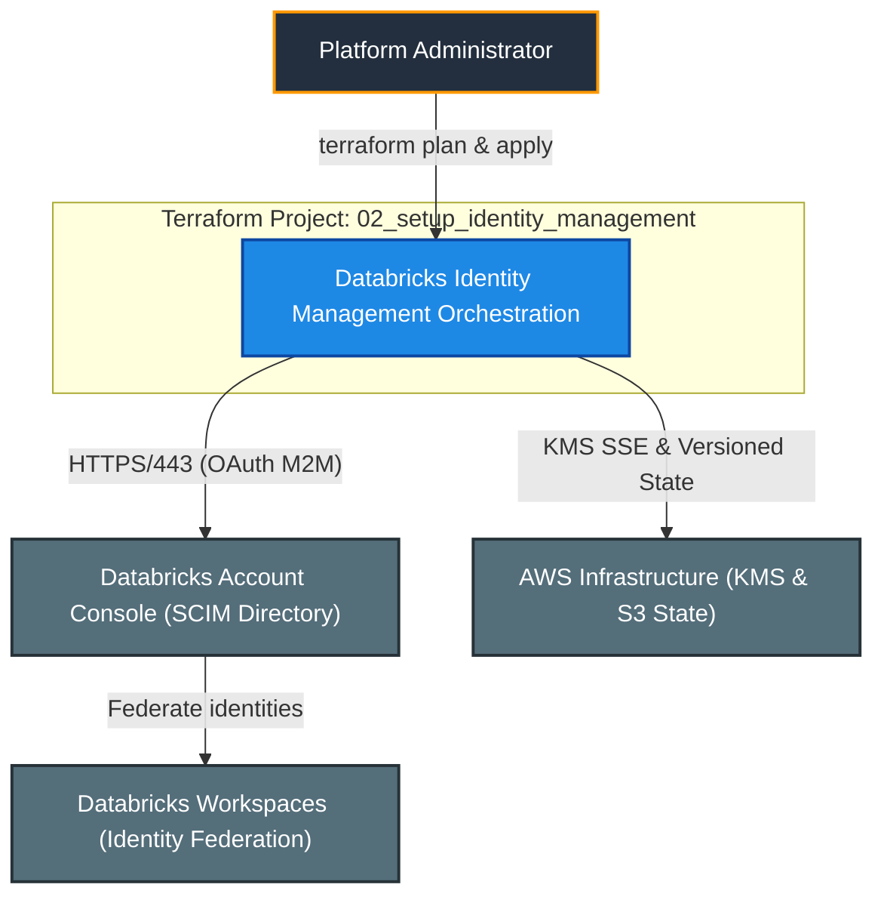
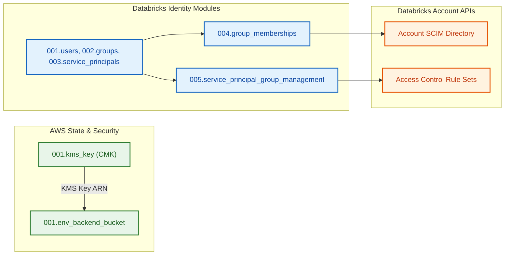
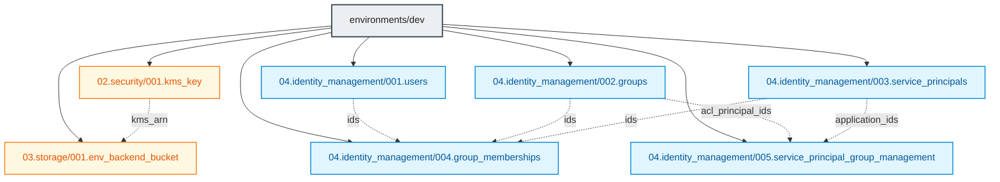

# Enterprise Databricks Identity Management

[](https://developer.hashicorp.com/terraform/docs)
[](https://registry.terraform.io/providers/hashicorp/aws/latest/docs)
[](https://registry.terraform.io/providers/databricks/databricks/latest/docs)
[](https://docs.databricks.com/aws/en/admin/users-groups/)
[](.github/workflows/README.md)

---

## 1. Executive Summary

- **Purpose & Scope**:
  This repository manages the foundational **account-level identity architecture and security baseline** for Enterprise Databricks on AWS via Terraform. It codifies the deployment of customer-managed KMS envelope encryption, versioned S3 remote state storage, account-level SCIM users, functional groups, system administrator role assignments, automated service principals, multi-entity group memberships, and authoritative service principal access control rule sets.
- **Problem Statement & Solution**:
  Managing cloud identity through manual console adjustments produces configuration drift, untracked privilege elevation, and inconsistent security postures across environments. This project solves identity sprawl by managing the full account identity catalogue as code, enabling peer-reviewed changes, automated testing, plan-time referential validation, and deterministic CI/CD deployments.
- **Key Business & Security Outcomes**:
  - **Single Source of Truth**: Centralized identity catalogue declared in `locals.tf` using stable logical keys and parameterized variables.
  - **Group-Centric Authorization (RBAC)**: All user and workload entitlements are managed through functional groups, enforcing least-privilege access.
  - **Machine Identity Governance**: Service principals are managed via authoritative access control rule sets (`roles/servicePrincipal.manager` and `roles/servicePrincipal.user`), preventing out-of-band privilege drift.
  - **At-Rest State Protection**: State files are safeguarded by a customer-managed KMS key with automatic rotation and a private, versioned S3 bucket.
  - **Modular Architecture**: Seven modular, single-responsibility Terraform modules under `modules/` orchestrated in the `environments/dev` root environment.

---

## 2. General Logic & Operational Flow

### 2.1 Configuration & Provisioning Lifecycle
1. **Security & State Bootstrap**:
   - Provisions customer-managed KMS key [`001.kms_key`](modules/02.security/001.kms_key/README.md) with annual rotation and root account delegation policy.
   - Provisions Amazon S3 bucket [`001.env_backend_bucket`](modules/03.storage/001.env_backend_bucket/README.md) with SSE-KMS encryption, versioning, Bucket Owner Enforced ownership, and 90-day historical version cleanup.
2. **Identity Catalogue Definition (`locals.tf`)**:
   - `users`: Declares human accounts parameterized by sensitive email input variables.
   - `groups`: Declares functional groups, designating administrative privilege via `account_admin = true`.
   - `service_principals`: Declares automated machine identities for CI/CD and data processing workloads.
   - `group_memberships`: Maps users, service principals, and nested groups into target groups.
   - `service_principal_group_roles`: Maps manager and user permissions on service principals to functional groups.
3. **Core Identity Provisioning**:
   - Instantiates [`001.users`](modules/04.identity_management/001.users/README.md), [`002.groups`](modules/04.identity_management/002.groups/README.md), and [`003.service_principals`](modules/04.identity_management/003.service_principals/README.md) via the account-level provider alias (`databricks.mws`).
4. **Relationship & Entitlement Binding**:
   - Ingests resolved IDs into [`004.group_memberships`](modules/04.identity_management/004.group_memberships/README.md) with plan-time referential integrity checks.
   - Passes application IDs and group ACL principal IDs into [`005.service_principal_group_management`](modules/04.identity_management/005.service_principal_group_management/README.md) to apply authoritative access control rule sets.

### 2.2 Quality Engineering & Toolchain
- **Pre-commit Automation**: Enforces formatting (`terraform fmt`), syntax hygiene, validation (`terraform validate`), and interface contracts via `terraform-docs` in [`TERRAFORM.md`](./environments/dev/TERRAFORM.md).
- **Static Analysis & Linting**: `tflint` configured with AWS ruleset and official Terraform checks (`.tflint.hcl`).
- **Security & Secret Scanning**: `gitleaks` prevents credential leakage, and `trivy` scans for High and Critical IaC misconfigurations (`.trivyignore`).
- **CI/CD Reusability**: Reusable GitHub Actions workflows (`.github/workflows/`) execute pre-commit checks, generate cached speculative plan artifacts, and gate apply actions behind environment approvals.

---

## 3. Architecture of the Repository

### 3.1 Repository Structure

```text
.
├── .ai/                                  # AI instructions, skills, and documentation templates
├── .github/workflows/                    # Reusable CI/CD GitHub Actions pipelines
├── environments/
│   └── dev/                              # Dev environment identity orchestration
│       ├── backend.tf                    # S3 remote state backend configuration
│       ├── locals.tf                     # Centralized identity catalogue and mappings
│       ├── main.tf                       # Module invocation and dependency graph
│       ├── providers.tf                  # AWS and Databricks account provider setups
│       ├── TERRAFORM.md                  # Auto-generated Terraform interface contract
│       ├── README.md                     # Dev environment documentation
│       └── variables.tf                  # Environment inputs and validations
└── modules/
    ├── 02.security/
    │   └── 001.kms_key/                  # Customer-managed KMS key for encryption
    ├── 03.storage/
    │   └── 001.env_backend_bucket/       # Encrypted S3 backend bucket for Terraform state
    └── 04.identity_management/
        ├── 001.users/                    # Account-level Databricks SCIM users
        ├── 002.groups/                   # Account-level groups and account_admin roles
        ├── 003.service_principals/       # Account-level service principals
        ├── 004.group_memberships/        # Multi-entity group membership associations
        └── 005.service_principal_group_management/ # Access control rule sets for SPs
```

### 3.2 Identity Model Catalogue

| Identifier Key | Kind | Parameters & Attributes | Purpose |
|:---|:---|:---|:---|
| `users` | `map(object)` | Email (`var.user1_email`, `var.user2_email`), display names | Human platform operators and engineers |
| `groups` | `map(object)` | `platform_admins` (`account_admin = true`), `data_engineers`, `data_scientists`, `data_analysts` | Functional RBAC access boundaries |
| `service_principals` | `map(object)` | `terraform_automation`, `etl_pipelines`, `data_science` | Non-human automation identities |
| `group_memberships` | `map(object)` | Composite lists: `users`, `service_principals`, `groups` | Assignment of principals into functional groups |
| `service_principal_group_roles` | `map(object)` | Role mappings: `managers`, `users` | Group-level delegation over service principals |

### 3.3 Security, IAM & Encryption Posture
- **Envelope Encryption**: S3 state bucket is protected by customer-managed KMS key with annual rotation (`enable_key_rotation = true`) and deletion protection.
- **Credential Protection**: Databricks OAuth client secrets, account IDs, and user email variables are marked `sensitive = true`, preventing plain-text leakage in logs.
- **Authoritative Rule Sets**: Service principal rule sets overwrite out-of-band modifications, ensuring deterministic infrastructure states.

---

## 4. Architecture C4 Visualisation

### 4.1 Level 1: System Context Diagram



### 4.2 Level 2: Container / Infrastructure Diagram



### 4.3 Level 3: Component Diagram (Terraform Resource Orchestration)



---

## 5. All Modules Used with Short Summaries

### 5.1 Module Inventory Table

| Module Name | Source Path | Documentation | Primary Role / Responsibility |
|:---|:---|:---:|:---|
| `kms_key` | `modules/02.security/001.kms_key` | [`README.md`](modules/02.security/001.kms_key/README.md) | Provisions customer-managed KMS key for backend state encryption |
| `backend_bucket` | `modules/03.storage/001.env_backend_bucket` | [`README.md`](modules/03.storage/001.env_backend_bucket/README.md) | Deploys hardened, encrypted S3 bucket with lifecycle cleanup |
| `users` | `modules/04.identity_management/001.users` | [`README.md`](modules/04.identity_management/001.users/README.md) | Manages account-level Databricks users via SCIM |
| `groups` | `modules/04.identity_management/002.groups` | [`README.md`](modules/04.identity_management/002.groups/README.md) | Manages account groups and delegates `account_admin` system role |
| `service_principals` | `modules/04.identity_management/003.service_principals` | [`README.md`](modules/04.identity_management/003.service_principals/README.md) | Provisions automated service principals and exports client IDs |
| `group_memberships` | `modules/04.identity_management/004.group_memberships` | [`README.md`](modules/04.identity_management/004.group_memberships/README.md) | Manages user, SP, and nested group membership links |
| `service_principal_group_management` | `modules/04.identity_management/005.service_principal_group_management` | [`README.md`](modules/04.identity_management/005.service_principal_group_management/README.md) | Configures authoritative Manager and User rule sets on service principals |

### 5.2 Deep-Dive Module Summaries

#### 1. [`001.kms_key`](modules/02.security/001.kms_key/README.md)
- **Source**: `modules/02.security/001.kms_key`
- **Purpose**: Creates the customer-managed AWS KMS key with annual rotation and root IAM delegation.
- **Key Exposed Outputs**: `kms_arn`.

#### 2. [`001.env_backend_bucket`](modules/03.storage/001.env_backend_bucket/README.md)
- **Source**: `modules/03.storage/001.env_backend_bucket`
- **Purpose**: Deploys the encrypted, versioned S3 backend storage bucket with SSE-KMS and 90-day version lifecycle expiration.
- **Key Exposed Outputs**: None (managed internally).

#### 3. [`001.users`](modules/04.identity_management/001.users/README.md)
- **Source**: `modules/04.identity_management/001.users`
- **Purpose**: Instantiates account-level Databricks users with email format validation and uniqueness enforcement.
- **Key Exposed Outputs**: `ids`.

#### 4. [`002.groups`](modules/04.identity_management/002.groups/README.md)
- **Source**: `modules/04.identity_management/002.groups`
- **Purpose**: Provisions account groups and attaches the `account_admin` system role to designated admin groups.
- **Key Exposed Outputs**: `ids`, `acl_principal_ids`.

#### 5. [`003.service_principals`](modules/04.identity_management/003.service_principals/README.md)
- **Source**: `modules/04.identity_management/003.service_principals`
- **Purpose**: Provisions non-human service principals for automated CI/CD and data pipeline workloads.
- **Key Exposed Outputs**: `ids`, `application_ids`.

#### 6. [`004.group_memberships`](modules/04.identity_management/004.group_memberships/README.md)
- **Source**: `modules/04.identity_management/004.group_memberships`
- **Purpose**: Flattens and binds users, service principals, and nested groups to parent groups with referential integrity checks.
- **Key Exposed Outputs**: None.

#### 7. [`005.service_principal_group_management`](modules/04.identity_management/005.service_principal_group_management/README.md)
- **Source**: `modules/04.identity_management/005.service_principal_group_management`
- **Purpose**: Applies authoritative default rule sets granting Manager and User roles to specified groups.
- **Key Exposed Outputs**: None.

---

## 6. Terraform Documentation Interface

> [!NOTE]
> The full machine-generated Terraform interface (Providers, Modules, Inputs, Outputs, and Resource definitions) is maintained by `terraform-docs` via pre-commit hooks in [`TERRAFORM.md`](./environments/dev/TERRAFORM.md).
>
> Please refer directly to [`TERRAFORM.md`](./environments/dev/TERRAFORM.md) for detailed variable schemas, default values, and data structures.

### 6.1 Essential Inputs Summary

| Variable | Type | Description | Sample / Constraint |
|:---|:---:|:---|:---|
| `aws_account_id` | `string` | Target 12-digit AWS Account ID | `"123456789012"` |
| `aws_region` | `string` | Deployment AWS region | `"eu-central-1"` |
| `environment` | `string` | Deployment environment qualifier | `"dev"` |
| `profile` | `string` | AWS CLI local profile | `"default"` |
| `databricks_account_id` | `string` | Databricks account UUID | Valid UUID |
| `service_principal_id` | `string` | Admin OAuth service principal client ID | OAuth client ID |
| `service_principal_secret` | `string` | Admin OAuth service principal secret (sensitive) | Sensitive string |
| `user1_email` | `string` | Email address for lead administrator user | Valid RFC email |
| `user2_email` | `string` | Email address for engineering user | Valid RFC email |

### 6.2 Essential Outputs Summary

This root environment configuration does not export Terraform outputs. State is stored remotely in S3, and identities are active within the Databricks Account console.

---

## 7. Important Links and Resources

### 7.1 Authoritative Databricks Documentation
- [Databricks on AWS Official Documentation](https://docs.databricks.com/aws/en/) - Core guide for Databricks cloud infrastructure on AWS.
- [Manage users, service principals, and groups](https://docs.databricks.com/aws/en/admin/users-groups/) - Identity management concepts for Databricks accounts.
- [Manage groups in Databricks](https://docs.databricks.com/aws/en/admin/users-groups/groups) - Account groups and membership governance.
- [Manage service principals](https://docs.databricks.com/aws/en/admin/users-groups/service-principals) - Service principal roles and access delegation.
- [Databricks Terraform Provider Documentation](https://registry.terraform.io/providers/databricks/databricks/latest/docs) - Provider registry documentation.

### 7.2 Authoritative AWS Documentation
- [AWS Official Documentation](https://docs.aws.amazon.com/) - Main portal for all AWS cloud service specifications.
- [AWS KMS Developer Guide](https://docs.aws.amazon.com/kms/latest/developerguide/overview.html) - AWS Key Management Service concepts.
- [Amazon S3 User Guide](https://docs.aws.amazon.com/AmazonS3/latest/userguide/Welcome.html) - Amazon S3 configuration and security guidelines.

### 7.3 Terraform & Tooling Documentation
- [Terraform Language Documentation](https://developer.hashicorp.com/terraform/docs) - HCL syntax, expressions, and configuration concepts.
- [terraform-docs Documentation](https://terraform-docs.io/) - Automated interface generation tool.

### 7.4 Internal Repository References
- [Dev Environment Documentation](environments/dev/README.md) - Environment-level deployment guide.
- [GitHub Actions Workflows Documentation](.github/workflows/README.md) - CI/CD pipeline automation guide.
- [Project Instructions & Source of Truth](file:///.ai/instructions.md) - Architectural guidelines and coding standards.
- [Authoritative README Template](file:///.ai/README_TEMPLATE.md) - Documentation standard.
