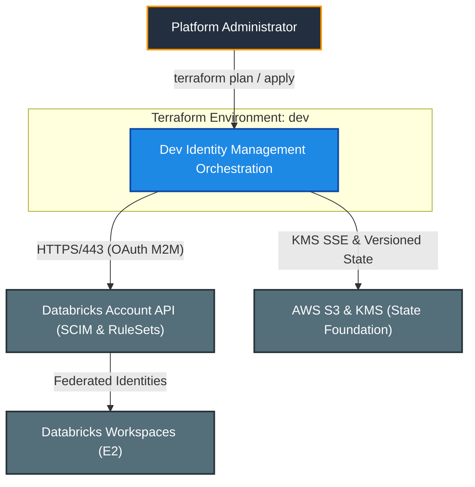
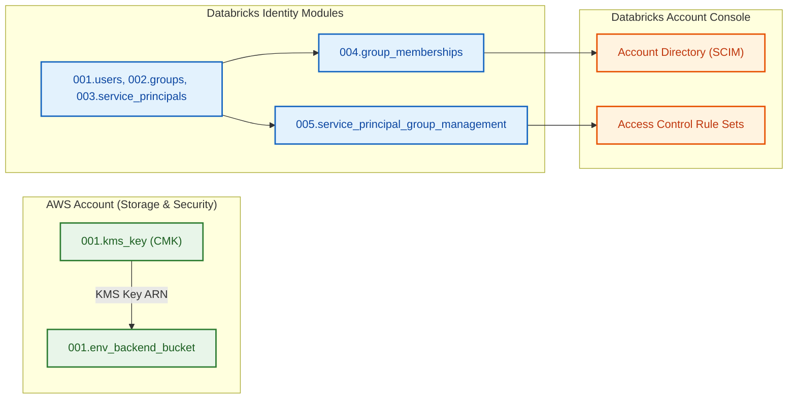
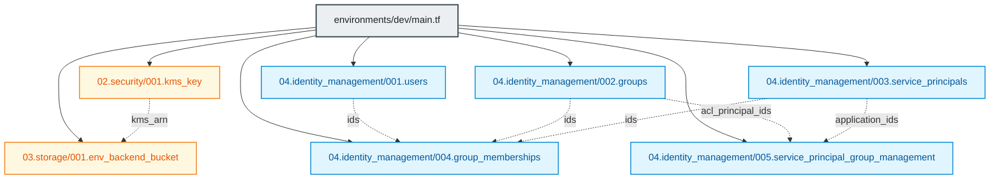

# Databricks Identity Management - Dev Environment (`environments/dev`)

---

## 1. Executive Summary

- **Purpose & Scope**:
  This environment orchestrates the core account-level identity governance model and remote state foundation for Databricks on AWS in the `dev` environment. It provisions customer-managed encryption (KMS CMK), a versioned S3 backend bucket, and an end-to-end identity fabric comprising users, functional groups, administrative role grants, service principals, multi-entity group memberships, and authoritative access control rule sets.
- **Problem Statement & Solution**:
  Ad-hoc console modifications and fragmented identity provisioning lead to unauthorized privilege escalation, non-reproducible environments, and auditing deficiencies. This environment solves this problem by defining the complete Databricks account identity catalogue in code (`locals.tf` and parameterized variables), ensuring consistent deployment, peer-reviewed modifications, and automated governance.
- **Key Business & Security Outcomes**:
  - **Single Source of Truth**: All identities, group memberships, and service principal delegations are declared centrally in `locals.tf`.
  - **Zero Direct-to-User Privilege**: All workspace and service principal privileges are conferred strictly through group memberships.
  - **Authoritative Service Principal Protection**: Machine identities are guarded by access control rule sets that prevent out-of-band credential tampering.
  - **At-Rest State Protection**: State files are safeguarded by a dedicated, customer-managed KMS key and a private, versioned S3 bucket.

---

## 2. General Logic & Operational Flow

### 2.1 Configuration & Provisioning Lifecycle
1. **Security & Storage Initialization**:
   - Deploys customer-managed KMS key [`001.kms_key`](file:///modules/02.security/001.kms_key).
   - Deploys S3 remote backend bucket [`001.env_backend_bucket`](file:///modules/03.storage/001.env_backend_bucket) encrypted with the KMS CMK.
2. **Identity Catalogue Definition (`locals.tf`)**:
   - Maps users (`user1`, `user2`) parameterized via sensitive email variables.
   - Declares groups (`platform_admins` with `account_admin = true`, `data_engineers`, `data_scientists`, `data_analysts`).
   - Declares workload service principals (`terraform_automation`, `etl_pipelines`, `data_science`).
   - Defines group memberships and service principal role delegations.
3. **Core Identity Provisioning**:
   - Concurrently provisions [`001.users`](file:///modules/04.identity_management/001.users), [`002.groups`](file:///modules/04.identity_management/002.groups), and [`003.service_principals`](file:///modules/04.identity_management/003.service_principals) using the account-level provider alias (`databricks.mws`).
4. **Relationship & Entitlement Binding**:
   - Passes resolved IDs to [`004.group_memberships`](file:///modules/04.identity_management/004.group_memberships) to associate users and service principals with groups.
   - Passes application IDs and group ACL principal strings to [`005.service_principal_group_management`](file:///modules/04.identity_management/005.service_principal_group_management) to establish authoritative access control rule sets.

### 2.2 Authentication & API Flow
- **AWS Provider**: Authenticates using the configured AWS profile and limits execution to `var.aws_account_id` to prevent cross-account deployment.
- **Databricks Provider (`databricks.mws`)**: Authenticates against `https://accounts.cloud.databricks.com` via OAuth M2M credentials (`service_principal_id` and sensitive `service_principal_secret`).

---

## 3. Architecture of the Environment

### 3.1 Identity Model Catalogue

| Identity / Component | Category | Attributes & Configuration | Operational Purpose |
|:---|:---|:---|:---|
| `user1` | User | Email: `var.user1_email`, Display Name: `User1Admin` | Lead platform operator |
| `user2` | User | Email: `var.user2_email`, Display Name: `User2` | Data team engineer |
| `platform_admins` | Group | `account_admin = true` | Databricks account administration |
| `data_engineers` | Group | Standard group | Data pipeline operations & development |
| `data_scientists` | Group | Standard group | Machine learning experimentation |
| `data_analysts` | Group | Standard group | BI & analytical reporting |
| `terraform_automation` | Service Principal | `sp-terraform-automation-dev` | CI/CD IaC execution |
| `etl_pipelines` | Service Principal | `sp-etl-pipelines-dev` | Scheduled data pipelines |
| `data_science` | Service Principal | `sp-data-science-dev` | Model training & deployment jobs |

### 3.2 Access & Entitlement Matrix

| Target Entity | Entitlement / Role | Granted To Groups | Description |
|:---|:---|:---|:---|
| **Account System** | `account_admin` | `platform_admins` | Full account administrative privileges |
| **`terraform_automation`** | `roles/servicePrincipal.manager` | `platform_admins` | Manage credentials and settings |
| **`terraform_automation`** | `roles/servicePrincipal.user` | `data_engineers` | Run workflows as the service principal |
| **`etl_pipelines`** | `roles/servicePrincipal.manager` | `platform_admins` | Manage credentials and settings |
| **`etl_pipelines`** | `roles/servicePrincipal.user` | `data_engineers` | Trigger automated ETL runs |
| **`data_science`** | `roles/servicePrincipal.manager` | `platform_admins` | Manage credentials and settings |
| **`data_science`** | `roles/servicePrincipal.user` | `data_scientists` | Execute ML models as the service principal |

### 3.3 Security, IAM & Encryption Posture
- **State Security**: Remote state is stored in a private S3 bucket with customer-managed KMS key encryption, enforced bucket ownership, and versioning.
- **Secret Isolation**: OAuth client secrets and user email addresses are marked `sensitive = true`, preventing plaintext exposure in console logs.
- **Authoritative Rule Sets**: Service principal permissions overwrite out-of-band grants, maintaining deterministic state.

---

## 4. Architecture C4 Visualisation

### 4.1 Level 1: System Context Diagram

### 4.2 Level 2: Container / Infrastructure Diagram

### 4.3 Level 3: Component Diagram (Terraform Resource Orchestration)

---

## 5. All Modules Used with Short Summaries

### 5.1 Module Inventory Table

| Module Name | Source Path | Version / Ref | Primary Role / Responsibility |
|:---|:---|:---:|:---|
| `kms_key` | `../../modules/02.security/001.kms_key` | `n/a` | Provisions customer-managed KMS key for state encryption |
| `backend_bucket` | `../../modules/03.storage/001.env_backend_bucket` | `n/a` | Deploys encrypted, versioned S3 bucket for Terraform state storage |
| `users` | `../../modules/04.identity_management/001.users` | `n/a` | Provisions account-level Databricks users via SCIM |
| `groups` | `../../modules/04.identity_management/002.groups` | `n/a` | Provisions account groups and binds `account_admin` system role |
| `service_principals` | `../../modules/04.identity_management/003.service_principals` | `n/a` | Deploys workload service principals and captures application IDs |
| `group_memberships` | `../../modules/04.identity_management/004.group_memberships` | `n/a` | Binds users, service principals, and nested groups into target groups |
| `service_principal_group_management` | `../../modules/04.identity_management/005.service_principal_group_management` | `n/a` | Configures authoritative access rule sets on service principals |

### 5.2 Deep-Dive Module Summaries

#### 1. `001.kms_key`
- **Source**: `../../modules/02.security/001.kms_key`
- **Purpose**: Creates the root cryptographic key with annual rotation and root account delegation policy.
- **Key Exposed Outputs**: `kms_arn`.

#### 2. `001.env_backend_bucket`
- **Source**: `../../modules/03.storage/001.env_backend_bucket`
- **Purpose**: Creates the private, versioned S3 backend storage bucket with SSE-KMS and 90-day version lifecycle expiration.
- **Key Exposed Outputs**: None (managed internally).

#### 3. `001.users`
- **Source**: `../../modules/04.identity_management/001.users`
- **Purpose**: Instantiates account users with email validation and unique display names.
- **Key Exposed Outputs**: `ids`.

#### 4. `002.groups`
- **Source**: `../../modules/04.identity_management/002.groups`
- **Purpose**: Deploys RBAC groups and attaches the `account_admin` system role to `platform_admins`.
- **Key Exposed Outputs**: `ids`, `acl_principal_ids`.

#### 5. `003.service_principals`
- **Source**: `../../modules/04.identity_management/003.service_principals`
- **Purpose**: Provisions machine identities for automated CI/CD and data pipeline workloads.
- **Key Exposed Outputs**: `ids`, `application_ids`.

#### 6. `004.group_memberships`
- **Source**: `../../modules/04.identity_management/004.group_memberships`
- **Purpose**: Flattens and validates group membership links across users and service principals.
- **Key Exposed Outputs**: None.

#### 7. `005.service_principal_group_management`
- **Source**: `../../modules/04.identity_management/005.service_principal_group_management`
- **Purpose**: Applies authoritative default rule sets granting Manager and User roles to specific groups.
- **Key Exposed Outputs**: None.

---

## 6. Terraform Documentation Interface

> [!NOTE]
> Detailed interface contracts for this environment are maintained by `terraform-docs` in [`TERRAFORM.md`](./TERRAFORM.md).

### 6.1 Essential Inputs Summary

| Variable | Type | Description | Sample / Constraint |
|:---|:---:|:---|:---|
| `aws_account_id` | `string` | Target 12-digit AWS Account ID | `"123456789012"` |
| `aws_region` | `string` | Deployment AWS region | `"eu-central-1"` |
| `environment` | `string` | Target environment qualifier | `"dev"` |
| `profile` | `string` | AWS CLI local profile | `"default"` |
| `databricks_account_id` | `string` | Databricks account UUID | Valid UUID |
| `service_principal_id` | `string` | Admin OAuth service principal client ID | OAuth client ID |
| `service_principal_secret` | `string` | Admin OAuth service principal secret (sensitive) | Sensitive string |
| `user1_email` | `string` | Email address for lead administrator user | Valid RFC email |
| `user2_email` | `string` | Email address for engineering user | Valid RFC email |

### 6.2 Essential Outputs Summary

This root environment configuration does not export Terraform outputs. State is stored remotely in S3, and identities are active within the Databricks Account console.

---

## 7. Important Links and Resources

### 7.1 Authoritative Databricks Documentation
- [Databricks on AWS Official Documentation](https://docs.databricks.com/aws/en/) - Core platform documentation.
- [Manage users, service principals, and groups](https://docs.databricks.com/aws/en/admin/users-groups/) - Identity management concepts.
- [Manage groups](https://docs.databricks.com/aws/en/admin/users-groups/groups) - Group governance guide.
- [Manage service principals](https://docs.databricks.com/aws/en/admin/users-groups/service-principals) - Service principal management guide.
- [Databricks Terraform Provider Documentation](https://registry.terraform.io/providers/databricks/databricks/latest/docs) - Provider guide.

### 7.2 Terraform & Tooling Documentation
- [Terraform Language Documentation](https://developer.hashicorp.com/terraform/docs) - HCL syntax and expressions.
- [terraform-docs Documentation](https://terraform-docs.io/) - Automated interface generation tool.

### 7.3 Internal Repository References
- [Terraform Interface (`TERRAFORM.md`)](./TERRAFORM.md) - Interface documentation.
- [Root Repository README](../../README.md) - Global architecture overview.
- [Project Instructions & Source of Truth](file:///.ai/instructions.md) - Repository governance.
- [Authoritative README Template](file:///.ai/README_TEMPLATE.md) - Documentation standard.
