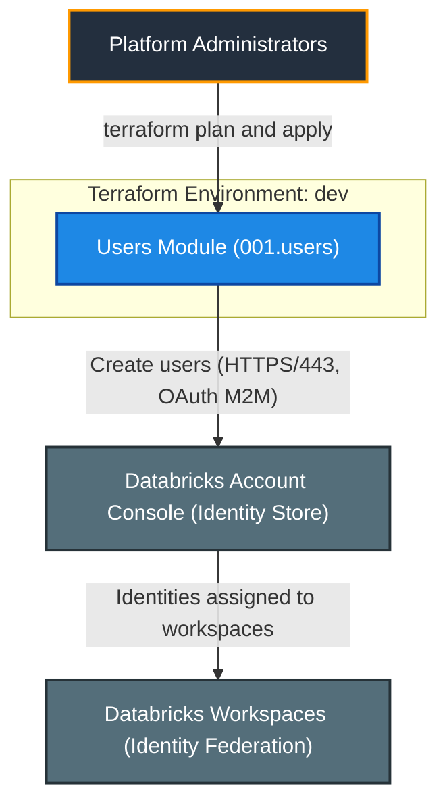
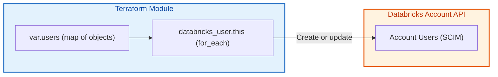
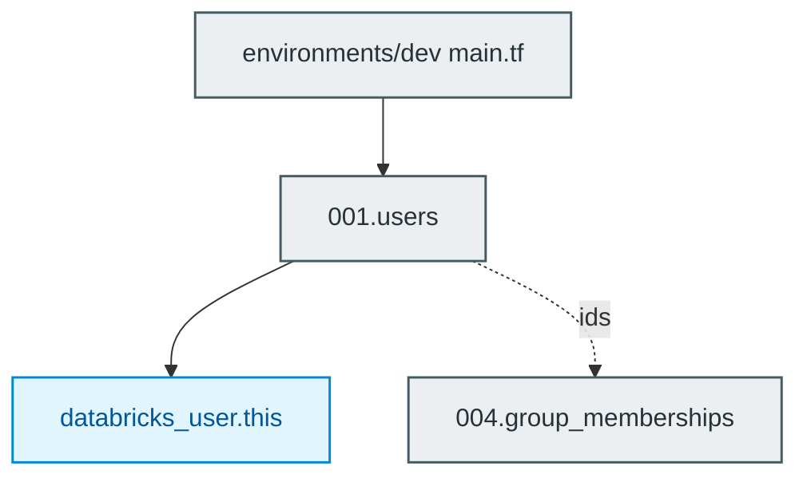

# Databricks Users Module (`001.users`)

[](https://developer.hashicorp.com/terraform/docs)
[](https://registry.terraform.io/providers/databricks/databricks/latest/docs)
[](https://docs.databricks.com/aws/en/admin/users-groups/)

---

## 1. Executive Summary

- **Purpose & Scope**:
  Creates account-level Databricks users (`databricks_user`) from a single map input. It is the first building block of the identity management stack and is consumed by the group membership module.
- **Problem Statement & Solution**:
  Manually creating users in the Account Console is not reproducible or auditable. This module declares every user as code, using `for_each`, so onboarding and offboarding is a reviewed change to `locals.tf`.
- **Key Business & Security Outcomes**:
  - **Declarative onboarding**: One map entry per user, no copy-pasted resource blocks.
  - **Stable references**: Map keys are logical identifiers, so changing an email does not re-key dependent memberships.
  - **Input safety**: Validation rejects malformed or duplicate email addresses before any API call.

---

## 2. General Logic & Operational Flow

### 2.1 Configuration & Provisioning Lifecycle
1. **Variable resolution**: `var.users` is a `map(object)` with optional `display_name`, `active` (default `true`) and `external_id`.
2. **Resource creation**: `databricks_user.this` uses `for_each = var.users`.
3. **Output exposure**: `ids` and `user_names` are maps keyed by the same logical key.

### 2.2 Identity & Data Flow
- **Control flow**: Terraform -> OAuth M2M service principal -> Databricks Account SCIM API -> user records.
- **Downstream**: `ids` feeds `004.group_memberships`.

---

## 3. Architecture of the Module

### 3.1 Resource Architecture & Attributes

| Resource | Cardinality | Key Attributes |
|:---|:---:|:---|
| `databricks_user.this` | one per map entry | `user_name`, `display_name`, `active`, `external_id` |

### 3.2 Reference Usage
```hcl
module "users" {
  source    = "../../modules/04.identity_management/001.users"
  providers = { databricks = databricks.mws }
  users = {
    alice = { user_name = "alice@example.com", display_name = "Alice" }
  }
}
```

### 3.3 Security, IAM & Encryption Posture
- **Least privilege**: only the identity record is created; no entitlements or roles are granted here.
- **Validation**: `user_name` must be an email and unique (case-insensitive).
- **Secrets**: no credentials are handled by this module.

---

## 4. Architecture C4 Visualisation

### 4.1 Level 1: System Context Diagram


### 4.2 Level 2: Container / Infrastructure Diagram


### 4.3 Level 3: Component Diagram (Terraform Resource Orchestration)


---

## 5. All Modules Used with Short Summaries

### 5.1 Module Inventory Table

| Module Name | Source Path | Version / Ref | Primary Role / Responsibility |
|:---|:---|:---:|:---|
| `users` | `modules/04.identity_management/001.users` | `n/a` | Creates account-level users. |

This is a leaf module and does not invoke submodules.

---

## 6. Terraform Documentation Interface

> [!NOTE]
> The full machine-generated Terraform interface (Providers, Modules, Inputs, Outputs, and Resource definitions) is maintained by `terraform-docs` via pre-commit hooks in [`TERRAFORM.md`](./TERRAFORM.md).
>
> Please refer directly to [`TERRAFORM.md`](./TERRAFORM.md) for detailed variable schemas, default values, and data structures.

### 6.1 Essential Inputs Summary

| Variable | Type | Description | Sample Value |
|:---|:---:|:---|:---|
| `users` | `map(object)` | Users keyed by logical identifier | `{ alice = { user_name = "alice@example.com" } }` |

### 6.2 Essential Outputs Summary

| Output | Description | Downstream Consumer |
|:---|:---|:---|
| `ids` | Map of key => user ID | `004.group_memberships` |
| `user_names` | Map of key => email | Reporting / auditing |

---

## 7. Important Links and Resources

- [databricks_user resource](https://registry.terraform.io/providers/databricks/databricks/latest/docs/resources/user) - Provider documentation for the managed resource.

### 7.1 Authoritative Databricks Documentation
- [Databricks on AWS Official Documentation](https://docs.databricks.com/aws/en/) - Core guide for Databricks on AWS.
- [Manage users, service principals, and groups](https://docs.databricks.com/aws/en/admin/users-groups/) - Identity management concepts for Databricks accounts.
- [Manage groups](https://docs.databricks.com/aws/en/admin/users-groups/groups) - Account groups and membership.
- [Manage service principals](https://docs.databricks.com/aws/en/admin/users-groups/service-principals) - Service principal roles (Manager, User) and management.
- [Databricks Terraform Provider Documentation](https://registry.terraform.io/providers/databricks/databricks/latest/docs) - Terraform registry provider guide for Databricks resources.

### 7.2 Terraform & Tooling Documentation
- [Terraform Language Documentation](https://developer.hashicorp.com/terraform/docs) - HCL syntax, expressions, and configuration concepts.
- [terraform-docs Documentation](https://terraform-docs.io/) - Automated interface generation tool used for [`TERRAFORM.md`](./TERRAFORM.md).

### 7.3 Internal Repository References
- [Project Instructions & Source of Truth](file:///.ai/instructions.md) - Architectural guidelines and coding standards.
- [Authoritative README Template](file:///.ai/README_TEMPLATE.md) - This template specification.
