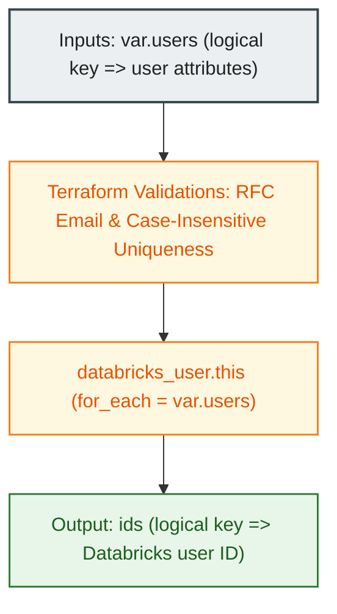

# Databricks Account-Level Users Module (`001.users`)

[](https://developer.hashicorp.com/terraform/docs)
[](https://registry.terraform.io/providers/databricks/databricks/latest/docs)
[](https://docs.databricks.com/aws/en/admin/users-groups/)

---

## 1. Executive Summary

- **Purpose & Scope**:
  This module provisions and manages account-level Databricks users via the Databricks SCIM API using the account-level provider (`databricks.mws`). It establishes the foundational human identities required for enterprise authentication and identity federation across Databricks E2 workspaces.
- **Problem Statement & Solution**:
  Manually provisioning users through the Databricks Account Console creates administrative friction, leads to configuration drift, and lacks auditable change control. This module solves this by codifying user provisioning in Terraform with strict input validations, including case-insensitive email uniqueness and standard RFC email format enforcement.
- **Key Business & Security Outcomes**:
  - **Account-Level Identity Federation**: Users defined at the account level can be mapped and federated into any workspace within the account without redundant account provisioning.
  - **State Stability**: Uses stable logical map keys to index resources, ensuring that metadata or email updates do not trigger destructive recreation cycles.
  - **Least Privilege Baselines**: Users are provisioned without intrinsic administrative privileges, deferring authorization to explicit group assignments.

---

## 2. General Logic & Operational Flow

### 2.1 Configuration & Provisioning Lifecycle
1. **Variable Ingestion & Validation**: Ingests `var.users` map and evaluates schema preconditions:
   - Validates that every `user_name` matches a valid email address format (`^[^@\s]+@[^@\s]+\.[^@\s]+$`).
   - Verifies that all `user_name` values are distinct using a case-insensitive uniqueness check.
2. **Resource Iteration**: Dynamically instantiates a `databricks_user.this` resource for each key in `var.users` using `for_each`.
3. **Attribute Configuration**: Sets the SCIM attributes `user_name` (email), optional `display_name`, `active` status flag (default `true`), and optional `external_id`.
4. **Identifier Output Export**: Gathers internal Databricks SCIM user IDs and exports the `ids` map for downstream membership resolution.

### 2.2 Operational Use Cases
- **Enterprise Onboarding**: Automates human identity lifecycle management during developer and platform engineer onboarding.
- **Group Membership Feeding**: Exports internal Databricks user IDs into [`004.group_memberships`](file:///modules/04.identity_management/004.group_memberships) to associate users with functional groups.

---

## 3. Architecture of the Module

### 3.1 Resource Architecture & Attributes

| Resource Type | Identifier | Configuration Attributes | Operational Purpose |
|:---|:---|:---|:---|
| `databricks_user` | `this` | `user_name`, `display_name`, `active`, `external_id` | SCIM user object created at Databricks account level |

### 3.2 Reference Usage
The module expects a map of user objects where keys serve as stable logical identifiers:

```hcl
module "users" {
  source = "../../modules/04.identity_management/001.users"

  providers = {
    databricks = databricks.mws
  }

  users = {
    user1 = {
      user_name    = "alice@example.com"
      display_name = "Alice Admin"
    }
    user2 = {
      user_name    = "bob@example.com"
      display_name = "Bob Engineer"
    }
  }
}
```

### 3.3 Security & Access Control Posture
- **Account Scope**: Resources are deployed strictly against the Databricks Account API (`https://accounts.cloud.databricks.com`), ensuring centralized governance across all linked workspaces.
- **Authentication**: Requires OAuth M2M credentials with Account Admin role on the caller service principal.
- **Access Delegation**: Newly created users possess zero workspace access or administrative roles until explicitly granted via group memberships or workspace assignments.

---

## 4. Architecture C4 Visualisation

### 4.1 Level 2: Component Diagram



---

## 5. All Modules Used with Short Summaries

This module does not invoke any submodules. It provisions native Databricks provider resources directly.

- **Downstream Consumers**:
  - [`004.group_memberships`](file:///modules/04.identity_management/004.group_memberships) - Consumes `module.users.ids` to add users to groups.
  - [`environments/dev`](file:///environments/dev) - Environment layer orchestrating user lifecycle.

---

## 6. Terraform Documentation Interface

> [!NOTE]
> Machine-generated interface specifications for this module are maintained by `terraform-docs` in [`TERRAFORM.md`](./TERRAFORM.md).

### 6.1 Essential Inputs Summary

| Variable | Type | Description | Required |
|:---|:---:|:---|:---:|
| `users` | `map(object)` | Map of users to provision. Map keys are stable logical IDs; `user_name` is the user's email address. | No (default: `{}`) |

### 6.2 Essential Outputs Summary

| Output | Type | Description | Downstream Consumer |
|:---|:---:|:---|:---|
| `ids` | `map(string)` | Map of logical user key => internal Databricks user ID | [`004.group_memberships`](file:///modules/04.identity_management/004.group_memberships) |

---

## 7. Important Links and Resources

### 7.1 Authoritative Databricks Documentation
- [Databricks on AWS Official Documentation](https://docs.databricks.com/aws/en/) - Core guide for Databricks cloud infrastructure on AWS.
- [Manage users, service principals, and groups](https://docs.databricks.com/aws/en/admin/users-groups/) - Databricks identity management architecture.
- [Databricks Terraform Provider Documentation](https://registry.terraform.io/providers/databricks/databricks/latest/docs) - Provider registry documentation.
- [databricks_user Resource Documentation](https://registry.terraform.io/providers/databricks/databricks/latest/docs/resources/user) - Resource configuration options.

### 7.2 Terraform & Tooling Documentation
- [Terraform Language Documentation](https://developer.hashicorp.com/terraform/docs) - HCL syntax and expressions.
- [terraform-docs Documentation](https://terraform-docs.io/) - Automated interface generation tool.

### 7.3 Internal Repository References
- [Terraform Interface (`TERRAFORM.md`)](./TERRAFORM.md) - Auto-generated inputs and outputs schema.
- [Group Memberships Module (`004.group_memberships`)](file:///modules/04.identity_management/004.group_memberships) - Downstream membership mapping.
- [Project Instructions & Source of Truth](file:///.ai/instructions.md) - Repository governance.
- [Authoritative README Template](file:///.ai/README_TEMPLATE.md) - Documentation standard.
