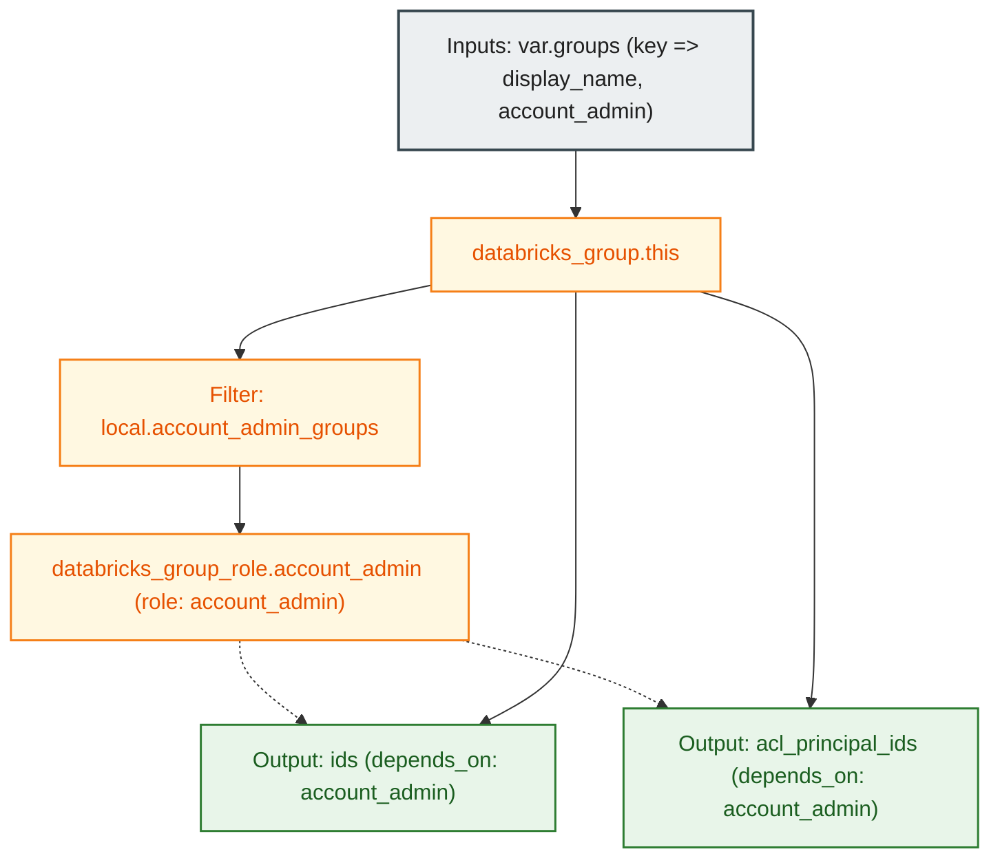

# Databricks Account-Level Groups Module (`002.groups`)

[](https://developer.hashicorp.com/terraform/docs)
[](https://registry.terraform.io/providers/databricks/databricks/latest/docs)
[](https://docs.databricks.com/aws/en/admin/users-groups/groups)

---

## 1. Executive Summary

- **Purpose & Scope**:
  This module provisions account-level Databricks groups and manages account administration role attachments via the Databricks SCIM and Account API. Groups form the core abstraction for enterprise Role-Based Access Control (RBAC) across Databricks workspaces.
- **Problem Statement & Solution**:
  Assigning permissions directly to individual users or service principals causes access sprawl, operational bottlenecks, and auditing challenges. This module enforces group-centric access management. Furthermore, it automates the assignment of the `account_admin` system role to designated administrative groups, eliminating manual console role assignments while preventing race conditions during downstream resource creation.
- **Key Business & Security Outcomes**:
  - **Group-Centric Authorization**: Groups act as single points of control for workspace entitlements, cluster policies, and data access.
  - **Automated Privilege Delegation**: Assigns the `account_admin` system role declaratively via `databricks_group_role`.
  - **Deterministic Dependency Graph**: Exports group IDs and ACL principal IDs with explicit completion barriers (`depends_on`), ensuring role assignments are fully propagated before dependent memberships and rule sets are applied.

---

## 2. General Logic & Operational Flow

### 2.1 Configuration & Provisioning Lifecycle
1. **Variable Ingestion & Validation**: Ingests `var.groups` and enforces schema validations:
   - Ensures each group `display_name` is non-empty.
   - Ensures all group `display_name` values are unique across the account.
2. **Group Resource Creation**: Provisions `databricks_group.this` for each entry in `var.groups` using `for_each`.
3. **Admin Role Evaluation**: Evaluates `local.account_admin_groups`, filtering for groups where `account_admin = true`.
4. **Role Assignment**: Deploys `databricks_group_role.account_admin` resources, binding the `account_admin` role to filtered groups.
5. **Output Export**: Exports:
   - `ids`: Mapping of group logical keys to internal SCIM group IDs.
   - `acl_principal_ids`: Mapping of group logical keys to SCIM ACL principal IDs (`groups/<display_name>`).
   - Both outputs enforce `depends_on = [databricks_group_role.account_admin]`.

### 2.2 Operational Use Cases
- **Platform Administration**: Provisions platform admin groups with account administration rights.
- **Functional Role Partitioning**: Creates functional engineering, data science, and analytics groups.
- **Downstream Orchestration**: Feeds group IDs to [`004.group_memberships`](file:///modules/04.identity_management/004.group_memberships) and ACL principal strings to [`005.service_principal_group_management`](file:///modules/04.identity_management/005.service_principal_group_management).

---

## 3. Architecture of the Module

### 3.1 Resource Architecture & Attributes

| Resource Type | Identifier | Configuration Attributes | Operational Purpose |
|:---|:---|:---|:---|
| `databricks_group` | `this` | `display_name`, `external_id`, `force` | Account-level group object |
| `databricks_group_role` | `account_admin` | `group_id`, `role = "account_admin"` | System role grant assigning account admin capabilities |

### 3.2 Reference Usage

```hcl
module "groups" {
  source = "../../modules/04.identity_management/002.groups"

  providers = {
    databricks = databricks.mws
  }

  groups = {
    platform_admins = {
      display_name  = "dbx-platform-admins"
      account_admin = true
    }
    data_engineers = {
      display_name = "dbx-data-engineers"
    }
  }
}
```

### 3.3 Security & Access Control Posture
- **Separation of Duties**: Only groups with `account_admin = true` receive account administrative rights; all other groups are provisioned as standard non-privileged groups.
- **ACL Principal Format**: Automatically exports canonical SCIM ACL principal identifiers (`groups/<display_name>`) required by Databricks access control rule sets.
- **Race Condition Prevention**: Downstream consumers cannot reference group IDs until administrative role assignments finish.

---

## 4. Architecture C4 Visualisation

### 4.1 Level 2: Component Diagram



---

## 5. All Modules Used with Short Summaries

This module provisions native Databricks provider resources directly without submodules.

- **Downstream Consumers**:
  - [`004.group_memberships`](file:///modules/04.identity_management/004.group_memberships) - Uses `ids` to associate members with groups.
  - [`005.service_principal_group_management`](file:///modules/04.identity_management/005.service_principal_group_management) - Uses `acl_principal_ids` for service principal access rule sets.
  - [`environments/dev`](file:///environments/dev) - Environment layer orchestrator.

---

## 6. Terraform Documentation Interface

> [!NOTE]
> Machine-generated interface specifications for this module are maintained by `terraform-docs` in [`TERRAFORM.md`](./TERRAFORM.md).

### 6.1 Essential Inputs Summary

| Variable | Type | Description | Required |
|:---|:---:|:---|:---:|
| `groups` | `map(object)` | Map of groups to create. Map keys are stable logical IDs; `display_name` is the group name. Supports optional `account_admin = true`. | No (default: `{}`) |

### 6.2 Essential Outputs Summary

| Output | Type | Description | Downstream Consumer |
|:---|:---:|:---|:---|
| `ids` | `map(string)` | Map of logical group key => Databricks group ID | [`004.group_memberships`](file:///modules/04.identity_management/004.group_memberships) |
| `acl_principal_ids` | `map(string)` | Map of logical group key => SCIM ACL principal ID (`groups/<display_name>`) | [`005.service_principal_group_management`](file:///modules/04.identity_management/005.service_principal_group_management) |

---

## 7. Important Links and Resources

### 7.1 Authoritative Databricks Documentation
- [Databricks on AWS Official Documentation](https://docs.databricks.com/aws/en/) - Core guide for Databricks cloud infrastructure on AWS.
- [Manage groups in Databricks](https://docs.databricks.com/aws/en/admin/users-groups/groups) - Group management architecture and best practices.
- [Databricks Terraform Provider Documentation](https://registry.terraform.io/providers/databricks/databricks/latest/docs) - Provider registry documentation.
- [databricks_group Resource Documentation](https://registry.terraform.io/providers/databricks/databricks/latest/docs/resources/group) - Group resource parameters.
- [databricks_group_role Resource Documentation](https://registry.terraform.io/providers/databricks/databricks/latest/docs/resources/group_role) - Group system role assignment.

### 7.2 Terraform & Tooling Documentation
- [Terraform Language Documentation](https://developer.hashicorp.com/terraform/docs) - HCL syntax and expressions.
- [terraform-docs Documentation](https://terraform-docs.io/) - Automated interface generation tool.

### 7.3 Internal Repository References
- [Terraform Interface (`TERRAFORM.md`)](./TERRAFORM.md) - Auto-generated inputs and outputs schema.
- [Group Memberships Module (`004.group_memberships`)](file:///modules/04.identity_management/004.group_memberships) - Downstream membership mapping.
- [Service Principal Group Management Module (`005.service_principal_group_management`)](file:///modules/04.identity_management/005.service_principal_group_management) - Rule sets assignment.
- [Project Instructions & Source of Truth](file:///.ai/instructions.md) - Repository governance.
- [Authoritative README Template](file:///.ai/README_TEMPLATE.md) - Documentation standard.
