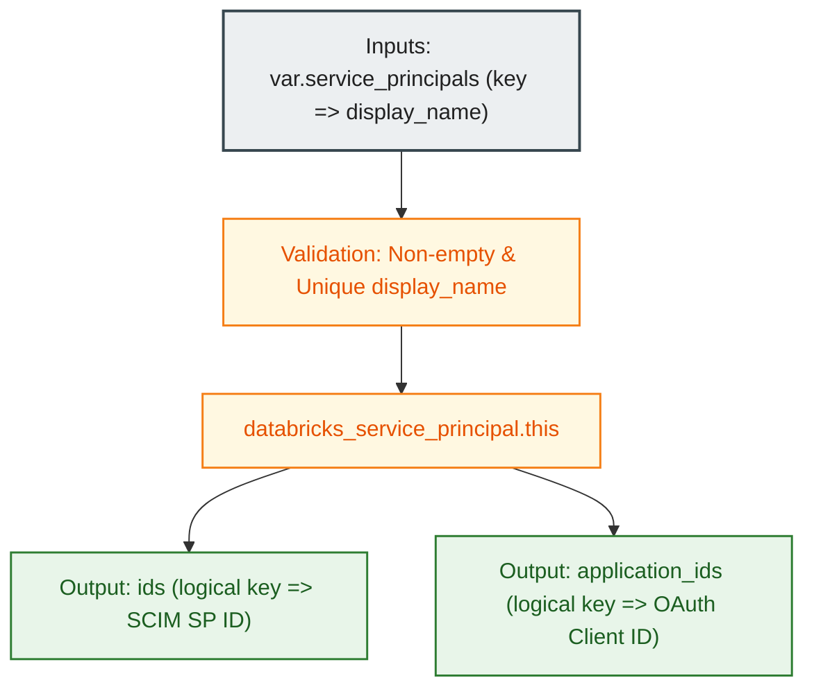

# Databricks Account-Level Service Principals Module (`003.service_principals`)

[](https://developer.hashicorp.com/terraform/docs)
[](https://registry.terraform.io/providers/databricks/databricks/latest/docs)
[](https://docs.databricks.com/aws/en/admin/users-groups/service-principals)

---

## 1. Executive Summary

- **Purpose & Scope**:
  This module provisions and manages account-level Databricks service principals via the Databricks SCIM API using the account-level provider (`databricks.mws`). It establishes non-human, automated machine identities for CI/CD pipelines, Terraform automation, and headless data processing workloads.
- **Problem Statement & Solution**:
  Running automated jobs or pipelines with human user accounts creates severe security vulnerabilities, including credential leakage, employee offboarding disruption, and lack of attribution. This module provisions dedicated, first-class Databricks service principals with platform-generated application IDs (client IDs) and lifecycle management.
- **Key Business & Security Outcomes**:
  - **Decoupled Machine Identities**: Isolates workload authentication from human user accounts.
  - **Automated Client ID Provisioning**: Captures and exports Databricks-generated OAuth application IDs (`application_id`) required for API tokens and access rule sets.
  - **Strict Naming Governance**: Validates that service principal display names are non-empty and unique across the account.

---

## 2. General Logic & Operational Flow

### 2.1 Configuration & Provisioning Lifecycle
1. **Variable Ingestion & Validation**: Ingests `var.service_principals` map and executes schema validations:
   - Validates that every `display_name` is non-empty.
   - Verifies case-sensitive uniqueness across all `display_name` values.
2. **Resource Iteration**: Iterates over `var.service_principals` using `for_each` and provisions `databricks_service_principal.this`.
3. **Identifier Generation**: Databricks assigns an internal SCIM ID and a UUID `application_id`.
4. **Output Export**: Exports:
   - `ids`: Mapping of logical keys to internal SCIM service principal IDs.
   - `application_ids`: Mapping of logical keys to Databricks OAuth client IDs (`application_id`).
   - Both outputs enforce `depends_on = [databricks_service_principal.this]`.

### 2.2 Operational Use Cases
- **Terraform CI/CD Automation**: Deploys the service principal identity used to automate infrastructure operations.
- **ETL Workload Execution**: Provisions service principals for orchestration tools (e.g., Airflow, dbt) to submit and run cluster jobs.
- **Access Rule Set Binding**: Exports `application_ids` to [`005.service_principal_group_management`](file:///modules/04.identity_management/005.service_principal_group_management) to configure group-level delegation rules.

---

## 3. Architecture of the Module

### 3.1 Resource Architecture & Attributes

| Resource Type | Identifier | Configuration Attributes | Operational Purpose |
|:---|:---|:---|:---|
| `databricks_service_principal` | `this` | `display_name`, `active`, `external_id` | Account-level machine identity and OAuth application entity |

### 3.2 Reference Usage

```hcl
module "service_principals" {
  source = "../../modules/04.identity_management/003.service_principals"

  providers = {
    databricks = databricks.mws
  }

  service_principals = {
    terraform_automation = {
      display_name = "sp-terraform-automation-dev"
    }
    etl_pipelines = {
      display_name = "sp-etl-pipelines-dev"
    }
  }
}
```

### 3.3 Security & Access Control Posture
- **No Inherent Privileges**: Service principals are created without default roles or workspace access, enforcing a strict zero-trust baseline.
- **Delegated Management**: Permissions on the service principal (e.g. who can generate secrets or use the identity) are managed through authoritative rule sets in module `005.service_principal_group_management`.
- **Active Status Control**: Service principals can be deactivated globally across the account via the `active` attribute without deleting historical ownership records.

---

## 4. Architecture C4 Visualisation

### 4.1 Level 2: Component Diagram



---

## 5. All Modules Used with Short Summaries

This module provisions native Databricks provider resources directly without submodules.

- **Downstream Consumers**:
  - [`004.group_memberships`](file:///modules/04.identity_management/004.group_memberships) - Uses `ids` to add service principals into functional groups.
  - [`005.service_principal_group_management`](file:///modules/04.identity_management/005.service_principal_group_management) - Uses `application_ids` to construct resource paths for access control rule sets.
  - [`environments/dev`](file:///environments/dev) - Environment layer orchestrator.

---

## 6. Terraform Documentation Interface

> [!NOTE]
> Machine-generated interface specifications for this module are maintained by `terraform-docs` in [`TERRAFORM.md`](./TERRAFORM.md).

### 6.1 Essential Inputs Summary

| Variable | Type | Description | Required |
|:---|:---:|:---|:---:|
| `service_principals` | `map(object)` | Map of service principals to provision. Map keys are stable logical IDs; `display_name` is the service principal name. | No (default: `{}`) |

### 6.2 Essential Outputs Summary

| Output | Type | Description | Downstream Consumer |
|:---|:---:|:---|:---|
| `ids` | `map(string)` | Map of logical SP key => internal Databricks SCIM ID | [`004.group_memberships`](file:///modules/04.identity_management/004.group_memberships) |
| `application_ids` | `map(string)` | Map of logical SP key => Databricks OAuth client ID (UUID) | [`005.service_principal_group_management`](file:///modules/04.identity_management/005.service_principal_group_management) |

---

## 7. Important Links and Resources

### 7.1 Authoritative Databricks Documentation
- [Databricks on AWS Official Documentation](https://docs.databricks.com/aws/en/) - Core guide for Databricks cloud infrastructure on AWS.
- [Manage service principals](https://docs.databricks.com/aws/en/admin/users-groups/service-principals) - Service principal concepts, roles, and management.
- [Databricks Terraform Provider Documentation](https://registry.terraform.io/providers/databricks/databricks/latest/docs) - Provider registry documentation.
- [databricks_service_principal Resource Documentation](https://registry.terraform.io/providers/databricks/databricks/latest/docs/resources/service_principal) - Resource configuration options.

### 7.2 Terraform & Tooling Documentation
- [Terraform Language Documentation](https://developer.hashicorp.com/terraform/docs) - HCL syntax and expressions.
- [terraform-docs Documentation](https://terraform-docs.io/) - Automated interface generation tool.

### 7.3 Internal Repository References
- [Terraform Interface (`TERRAFORM.md`)](./TERRAFORM.md) - Auto-generated inputs and outputs schema.
- [Group Memberships Module (`004.group_memberships`)](file:///modules/04.identity_management/004.group_memberships) - Group membership assignment.
- [Service Principal Group Management Module (`005.service_principal_group_management`)](file:///modules/04.identity_management/005.service_principal_group_management) - Rule sets assignment.
- [Project Instructions & Source of Truth](file:///.ai/instructions.md) - Repository governance.
- [Authoritative README Template](file:///.ai/README_TEMPLATE.md) - Documentation standard.
