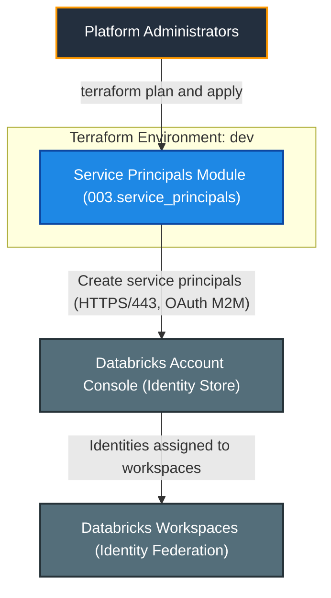
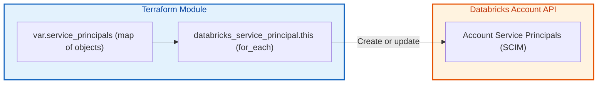
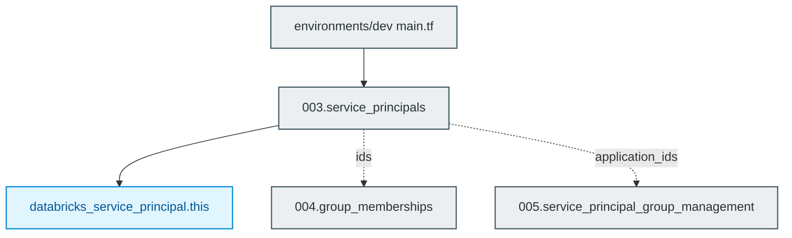

# Databricks Service Principals Module (`003.service_principals`)

[](https://developer.hashicorp.com/terraform/docs)
[](https://registry.terraform.io/providers/databricks/databricks/latest/docs)
[](https://docs.databricks.com/aws/en/admin/users-groups/)

---

## 1. Executive Summary

- **Purpose & Scope**:
  Creates account-level Databricks service principals (`databricks_service_principal`) from a single map input and exposes IDs, application IDs, and ACL principal IDs.
- **Problem Statement & Solution**:
  Automation and pipelines need non-human identities. This module declares them as code with `for_each`, removing manual console work and making their lifecycle reviewable.
- **Key Business & Security Outcomes**:
  - **Non-human identities**: Dedicated principals for CI/CD and pipelines instead of personal accounts.
  - **Reusable identifiers**: `ids` for group membership, `application_ids` and `acl_principal_ids` for rule sets.
  - **Input safety**: Validation enforces non-empty, unique display names.

---

## 2. General Logic & Operational Flow

### 2.1 Configuration & Provisioning Lifecycle
1. **Variable resolution**: `var.service_principals` is a `map(object)` with `display_name`, optional `active` (default `true`) and `external_id`.
2. **Resource creation**: `databricks_service_principal.this` uses `for_each`; the application ID is generated by Databricks on AWS.
3. **Output exposure**: `ids`, `application_ids`, and `acl_principal_ids` keyed by the logical key.

### 2.2 Identity & Data Flow
- **Control flow**: Terraform -> Databricks Account SCIM API -> service principal records.
- **Downstream**: `ids` feeds `004.group_memberships`; `application_ids` and `acl_principal_ids` feed `005.service_principal_group_management`.

---

## 3. Architecture of the Module

### 3.1 Resource Architecture & Attributes

| Resource | Cardinality | Key Attributes |
|:---|:---:|:---|
| `databricks_service_principal.this` | one per map entry | `display_name`, `active`, `external_id` |

### 3.2 Reference Usage
```hcl
module "service_principals" {
  source    = "../../modules/04.identity_management/003.service_principals"
  providers = { databricks = databricks.mws }
  service_principals = {
    etl = { display_name = "sp-etl-pipelines" }
  }
}
```

### 3.3 Security, IAM & Encryption Posture
- **Secrets**: no OAuth secrets are created here; generate them out-of-band so they never land in Terraform state unintentionally.
- **Least privilege**: no entitlements are granted by this module.

---

## 4. Architecture C4 Visualisation

### 4.1 Level 1: System Context Diagram


### 4.2 Level 2: Container / Infrastructure Diagram


### 4.3 Level 3: Component Diagram (Terraform Resource Orchestration)


---

## 5. All Modules Used with Short Summaries

### 5.1 Module Inventory Table

| Module Name | Source Path | Version / Ref | Primary Role / Responsibility |
|:---|:---|:---:|:---|
| `service_principals` | `modules/04.identity_management/003.service_principals` | `n/a` | Creates account-level service principals. |

This is a leaf module and does not invoke submodules.

---

## 6. Terraform Documentation Interface

> [!NOTE]
> The full machine-generated Terraform interface (Providers, Modules, Inputs, Outputs, and Resource definitions) is maintained by `terraform-docs` via pre-commit hooks in [`TERRAFORM.md`](./TERRAFORM.md).
>
> Please refer directly to [`TERRAFORM.md`](./TERRAFORM.md) for detailed variable schemas, default values, and data structures.

### 6.1 Essential Inputs Summary

| Variable | Type | Description | Sample Value |
|:---|:---:|:---|:---|
| `service_principals` | `map(object)` | Service principals keyed by logical identifier | `{ etl = { display_name = "sp-etl-pipelines" } }` |

### 6.2 Essential Outputs Summary

| Output | Description | Downstream Consumer |
|:---|:---|:---|
| `ids` | Map of key => service principal ID | `004.group_memberships` |
| `application_ids` | Map of key => application (client) ID | `005.service_principal_group_management` |
| `acl_principal_ids` | Map of key => ACL principal ID (`servicePrincipals/<application_id>`) | Access control / permissions |

---

## 7. Important Links and Resources

- [databricks_service_principal resource](https://registry.terraform.io/providers/databricks/databricks/latest/docs/resources/service_principal) - Provider documentation for the managed resource.

### 7.1 Authoritative Databricks Documentation
- [Databricks on AWS Official Documentation](https://docs.databricks.com/aws/en/) - Core guide for Databricks on AWS.
- [Manage users, service principals, and groups](https://docs.databricks.com/aws/en/admin/users-groups/) - Identity management concepts for Databricks accounts.
- [Manage groups](https://docs.databricks.com/aws/en/admin/users-groups/groups) - Account groups and membership.
- [Manage service principals](https://docs.databricks.com/aws/en/admin/users-groups/service-principals) - Service principal roles (Manager, User) and management.
- [Databricks Terraform Provider Documentation](https://registry.terraform.io/providers/databricks/databricks/latest/docs) - Terraform registry provider guide for Databricks resources.

### 7.2 Terraform & Tooling Documentation
- [Terraform Language Documentation](https://developer.hashicorp.com/terraform/docs) - HCL syntax, expressions, and configuration concepts.
- [terraform-docs Documentation](https://terraform-docs.io/) - Automated interface generation tool used for [`TERRAFORM.md`](./TERRAFORM.md).

### 7.3 Internal Repository References
- [Project Instructions & Source of Truth](file:///.ai/instructions.md) - Architectural guidelines and coding standards.
- [Authoritative README Template](file:///.ai/README_TEMPLATE.md) - This template specification.
