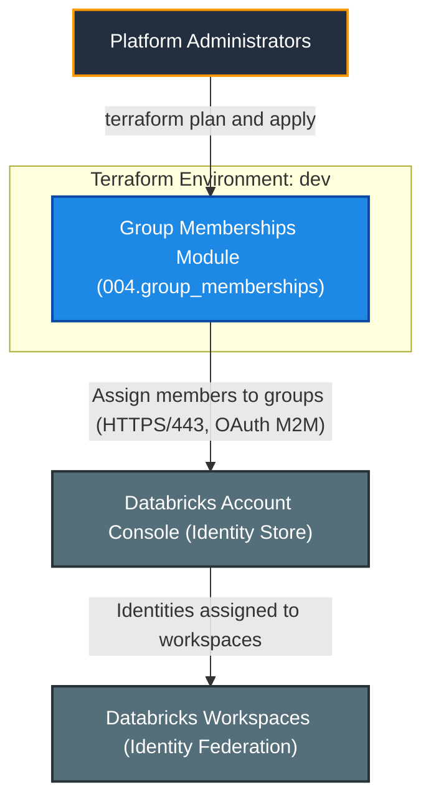
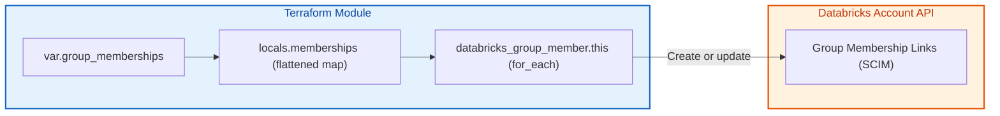
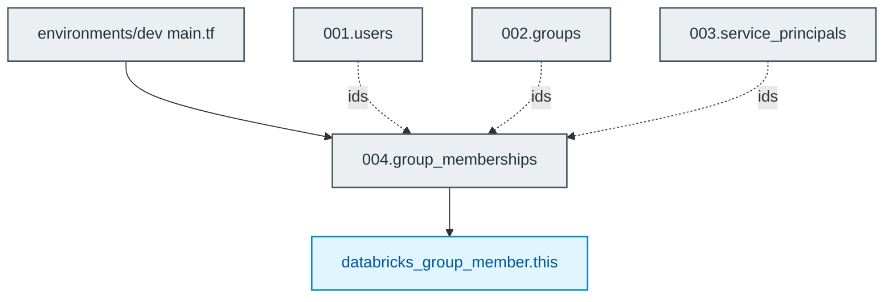

# Databricks Group Memberships Module (`004.group_memberships`)

[](https://developer.hashicorp.com/terraform/docs)
[](https://registry.terraform.io/providers/databricks/databricks/latest/docs)
[](https://docs.databricks.com/aws/en/admin/users-groups/)

---

## 1. Executive Summary

- **Purpose & Scope**:
  Assigns users, service principals and nested groups to groups using `databricks_group_member`, driven by one map of group key => member keys.
- **Problem Statement & Solution**:
  Membership is the glue of identity management. Declaring it as a flat map of logical keys keeps assignments readable, and flattening it in `locals.tf` yields one `for_each` resource for all member types.
- **Key Business & Security Outcomes**:
  - **No repetition**: One resource covers users, service principals and nested groups.
  - **Referential integrity**: Preconditions fail at plan time if a referenced group, user or service principal key does not exist, or a group contains itself.
  - **Idempotent changes**: Each membership has a stable key `<group>/<type>/<member>`.

---

## 2. General Logic & Operational Flow

### 2.1 Configuration & Provisioning Lifecycle
1. **Input resolution**: Receives ID maps from the users, groups and service principals modules plus `group_memberships`.
2. **Flattening**: `locals.tf` builds `user_memberships`, `service_principal_memberships` and `group_memberships` lists and merges them into `memberships`, a map keyed by `<group>/<type>/<member>`.
3. **Resource creation**: `databricks_group_member.this` uses `for_each = local.memberships`.

### 2.2 Identity & Data Flow
- **Control flow**: Terraform -> Databricks Account SCIM API -> group membership links.
- **Effect**: members inherit all permissions granted to the group; nested groups inherit transitively.

---

## 3. Architecture of the Module

### 3.1 Resource Architecture & Attributes

| Resource | Cardinality | Key Attributes |
|:---|:---:|:---|
| `databricks_group_member.this` | one per (group, member) pair | `group_id`, `member_id` |

### 3.2 Reference Usage
```hcl
module "group_memberships" {
  source    = "../../modules/04.identity_management/004.group_memberships"
  providers = { databricks = databricks.mws }

  group_ids             = module.groups.ids
  user_ids              = module.users.ids
  service_principal_ids = module.service_principals.ids
  group_memberships = {
    data_engineers = { users = ["alice"], service_principals = ["etl"] }
  }
}
```

### 3.3 Security, IAM & Encryption Posture
- **Least privilege**: membership is explicit; there are no implicit or wildcard assignments.
- **Cycle protection**: a group cannot be a member of itself (checked by precondition).

---

## 4. Architecture C4 Visualisation

### 4.1 Level 1: System Context Diagram


### 4.2 Level 2: Container / Infrastructure Diagram


### 4.3 Level 3: Component Diagram (Terraform Resource Orchestration)


---

## 5. All Modules Used with Short Summaries

### 5.1 Module Inventory Table

| Module Name | Source Path | Version / Ref | Primary Role / Responsibility |
|:---|:---|:---:|:---|
| `group_memberships` | `modules/04.identity_management/004.group_memberships` | `n/a` | Assigns users, service principals and groups to groups. |

This is a leaf module and does not invoke submodules. It depends on the outputs of `001.users`, `002.groups` and `003.service_principals`.

---

## 6. Terraform Documentation Interface

> [!NOTE]
> The full machine-generated Terraform interface (Providers, Modules, Inputs, Outputs, and Resource definitions) is maintained by `terraform-docs` via pre-commit hooks in [`TERRAFORM.md`](./TERRAFORM.md).
>
> Please refer directly to [`TERRAFORM.md`](./TERRAFORM.md) for detailed variable schemas, default values, and data structures.

### 6.1 Essential Inputs Summary

| Variable | Type | Description | Sample Value |
|:---|:---:|:---|:---|
| `group_ids` | `map(string)` | Group key => ID | `module.groups.ids` |
| `user_ids` | `map(string)` | User key => ID | `module.users.ids` |
| `service_principal_ids` | `map(string)` | Service principal key => ID | `module.service_principals.ids` |
| `group_memberships` | `map(object)` | Group key => lists of `users`, `service_principals`, `groups` keys | `{ data_engineers = { users = ["alice"] } }` |

### 6.2 Essential Outputs Summary

| Output | Description | Downstream Consumer |
|:---|:---|:---|
| `membership_ids` | Map of `<group>/<type>/<member>` => membership ID | Reporting / auditing |

---

## 7. Important Links and Resources

- [databricks_group_member resource](https://registry.terraform.io/providers/databricks/databricks/latest/docs/resources/group_member) - Provider documentation for the managed resource.

### 7.1 Authoritative Databricks Documentation
- [Databricks on AWS Official Documentation](https://docs.databricks.com/aws/en/) - Core guide for Databricks on AWS.
- [Manage users, service principals, and groups](https://docs.databricks.com/aws/en/admin/users-groups/) - Identity management concepts for Databricks accounts.
- [Manage groups](https://docs.databricks.com/aws/en/admin/users-groups/groups) - Account groups and membership.
- [Manage service principals](https://docs.databricks.com/aws/en/admin/users-groups/service-principals) - Service principal roles (Manager, User) and management.
- [Databricks Terraform Provider Documentation](https://registry.terraform.io/providers/databricks/databricks/latest/docs) - Terraform registry provider guide for Databricks resources.

### 7.2 Terraform & Tooling Documentation
- [Terraform Language Documentation](https://developer.hashicorp.com/terraform/docs) - HCL syntax, expressions, and configuration concepts.
- [terraform-docs Documentation](https://terraform-docs.io/) - Automated interface generation tool used for [`TERRAFORM.md`](./TERRAFORM.md).

### 7.3 Internal Repository References
- [Project Instructions & Source of Truth](file:///.ai/instructions.md) - Architectural guidelines and coding standards.
- [Authoritative README Template](file:///.ai/README_TEMPLATE.md) - This template specification.
