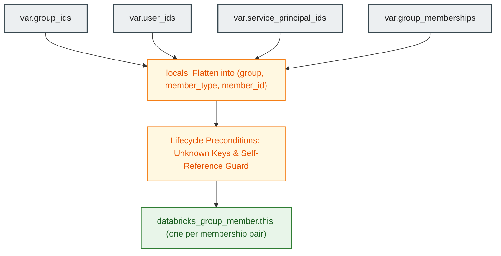

# Databricks Group Memberships Module (`004.group_memberships`)

[](https://developer.hashicorp.com/terraform/docs)
[](https://registry.terraform.io/providers/databricks/databricks/latest/docs)
[](https://docs.databricks.com/aws/en/admin/users-groups/groups)

---

## 1. Executive Summary

- **Purpose & Scope**:
  This module manages multi-entity group memberships across Databricks account-level groups via the SCIM API using the account-level provider (`databricks.mws`). It supports assigning users, service principals, and nested groups to target groups.
- **Problem Statement & Solution**:
  Managing SCIM group memberships across varied principal types can lead to dangling references, cyclic group relationships, and runtime API failures if IDs are misconfigured. This module addresses these issues by flattening multi-entity membership maps into discrete, uniquely identified group-member relationships while enforcing plan-time referential integrity and anti-recursion validations.
- **Key Business & Security Outcomes**:
  - **Comprehensive Multi-Entity Membership**: Supports binding users, service principals, and nested sub-groups under unified group declarations.
  - **Plan-Time Referential Integrity**: Detects undefined user keys, group keys, or service principal keys before sending API calls to Databricks.
  - **Recursion Prevention**: Enforces a strict guardrail blocking groups from listing themselves as nested members.

---

## 2. General Logic & Operational Flow

### 2.1 Configuration & Provisioning Lifecycle
1. **Input Map Resolution**: Accepts resolved ID maps from upstream identity modules:
   - `group_ids`: Logical group key => Databricks group ID.
   - `user_ids`: Logical user key => Databricks user ID.
   - `service_principal_ids`: Logical SP key => Databricks service principal ID.
   - `group_memberships`: High-level group specification declaring lists of member users, service principals, and nested groups.
2. **Local Structure Flattening**: In `locals.tf`, flattens memberships into unique composite entries:
   - User bindings: `<group_key>/user/<user_key>`.
   - Service principal bindings: `<group_key>/service_principal/<sp_key>`.
   - Nested group bindings: `<group_key>/group/<subgroup_key>`.
3. **Precondition Validation**: Executes four lifecycle preconditions within `databricks_group_member.this`:
   - Checks that all referenced group keys exist in `group_ids`.
   - Checks that all referenced user keys exist in `user_ids`.
   - Checks that all referenced service principal keys exist in `service_principal_ids`.
   - Verifies that no group references itself (`self_referencing_groups`).
4. **SCIM Membership Instantiation**: Creates discrete `databricks_group_member.this` resources for each entry in the flattened membership map.

### 2.2 Operational Use Cases
- **Role Assignment**: Adds data engineers and data scientists into functional groups granting workspace or data access.
- **Machine Identity Grouping**: Adds pipeline service principals into functional engineering groups.
- **Hierarchical Governance**: Establishes nested group inheritance where appropriate.

---

## 3. Architecture of the Module

### 3.1 Resource Architecture & Attributes

| Resource Type | Identifier | Configuration Attributes | Operational Purpose |
|:---|:---|:---|:---|
| `databricks_group_member` | `this` | `group_id`, `member_id` | SCIM group-to-member assignment link |

### 3.2 Reference Usage

```hcl
module "group_memberships" {
  source = "../../modules/04.identity_management/004.group_memberships"

  providers = {
    databricks = databricks.mws
  }

  group_ids             = module.groups.ids
  user_ids              = module.users.ids
  service_principal_ids = module.service_principals.ids

  group_memberships = {
    platform_admins = {
      users = ["user1"]
    }
    data_engineers = {
      users              = ["user1", "user2"]
      service_principals = ["etl_pipelines"]
    }
  }
}
```

### 3.3 Security & Access Control Posture
- **Deterministic State Mapping**: By composing keys as `<group>/<type>/<member>`, Terraform can add or remove individual member associations without mutating or recreating unrelated memberships.
- **Fail-Fast Integrity**: If a member or group is missing from the parent configuration, Terraform halts execution during the planning phase with a descriptive error message rather than creating partial state.

---

## 4. Architecture C4 Visualisation

### 4.1 Level 2: Component Diagram



---

## 5. All Modules Used with Short Summaries

This module does not invoke submodules. It coordinates IDs output by upstream identity modules:

- **Upstream Dependencies**:
  - [`001.users`](file:///modules/04.identity_management/001.users) - Supplies user IDs (`user_ids`).
  - [`002.groups`](file:///modules/04.identity_management/002.groups) - Supplies group IDs (`group_ids`).
  - [`003.service_principals`](file:///modules/04.identity_management/003.service_principals) - Supplies service principal IDs (`service_principal_ids`).
- **Consumers**:
  - [`environments/dev`](file:///environments/dev) - Root environment deploying group assignments.

---

## 6. Terraform Documentation Interface

> [!NOTE]
> Machine-generated interface specifications for this module are maintained by `terraform-docs` in [`TERRAFORM.md`](./TERRAFORM.md).

### 6.1 Essential Inputs Summary

| Variable | Type | Description | Required |
|:---|:---:|:---|:---:|\
| `group_ids` | `map(string)` | Map of logical group key => Databricks group ID | Yes |
| `user_ids` | `map(string)` | Map of logical user key => Databricks user ID | No (default: `{}`) |
| `service_principal_ids` | `map(string)` | Map of logical service principal key => Databricks SP ID | No (default: `{}`) |
| `group_memberships` | `map(object)` | Map of group key => lists of `users`, `service_principals`, and `groups` | No (default: `{}`) |

### 6.2 Essential Outputs Summary

No outputs are exported by this module. Group memberships establish internal relationships within Databricks SCIM directory objects.

---

## 7. Important Links and Resources

### 7.1 Authoritative Databricks Documentation
- [Databricks on AWS Official Documentation](https://docs.databricks.com/aws/en/) - Core guide for Databricks cloud infrastructure on AWS.
- [Manage groups and memberships](https://docs.databricks.com/aws/en/admin/users-groups/groups) - Identity management and group membership administration.
- [Databricks Terraform Provider Documentation](https://registry.terraform.io/providers/databricks/databricks/latest/docs) - Provider registry documentation.
- [databricks_group_member Resource Documentation](https://registry.terraform.io/providers/databricks/databricks/latest/docs/resources/group_member) - Resource syntax and arguments.

### 7.2 Terraform & Tooling Documentation
- [Terraform Language Documentation](https://developer.hashicorp.com/terraform/docs) - HCL syntax and expressions.
- [terraform-docs Documentation](https://terraform-docs.io/) - Automated interface generation tool.

### 7.3 Internal Repository References
- [Terraform Interface (`TERRAFORM.md`)](./TERRAFORM.md) - Auto-generated inputs schema.
- [Users Module (`001.users`)](file:///modules/04.identity_management/001.users) - Upstream user definitions.
- [Groups Module (`002.groups`)](file:///modules/04.identity_management/002.groups) - Upstream group definitions.
- [Service Principals Module (`003.service_principals`)](file:///modules/04.identity_management/003.service_principals) - Upstream SP definitions.
- [Project Instructions & Source of Truth](file:///.ai/instructions.md) - Repository governance.
- [Authoritative README Template](file:///.ai/README_TEMPLATE.md) - Documentation standard.
