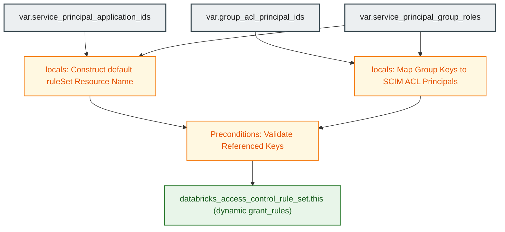

# Databricks Service Principal Group Management Module (`005.service_principal_group_management`)

[](https://developer.hashicorp.com/terraform/docs)
[](https://registry.terraform.io/providers/databricks/databricks/latest/docs)
[](https://docs.databricks.com/aws/en/admin/users-groups/service-principals)

---

## 1. Executive Summary

- **Purpose & Scope**:
  This module configures authoritative access control rule sets on account-level Databricks service principals using `databricks_access_control_rule_set` via the account-level provider (`databricks.mws`). It establishes role-based governance over machine identities by delegating Manager and User permissions to designated Databricks groups.
- **Problem Statement & Solution**:
  Allowing unrestricted usage or management of service principals creates significant security vulnerabilities, while manual privilege delegation through the console risks out-of-band permission drift. This module provides centralized, authoritative Access Control Rule Set management that explicitly grants `roles/servicePrincipal.manager` and `roles/servicePrincipal.user` to vetted groups while automatically revoking unauthorized out-of-band grants.
- **Key Business & Security Outcomes**:
  - **Authoritative Access Enforcement**: Rule sets manage all permissions on the target service principal; unmanaged grants are reconciled and purged.
  - **Granular Privilege Separation**:
    - **Manager Role (`roles/servicePrincipal.manager`)**: Authorizes groups (e.g., Platform Administrators) to generate OAuth secrets, modify attributes, and assign permissions.
    - **User Role (`roles/servicePrincipal.user`)**: Authorizes groups (e.g., Data Engineers) to execute jobs, runs, and clusters under the service principal identity without administrative rights.
  - **Referential Integrity Safeguards**: Plan-time preconditions detect and block missing service principal application IDs or unresolvable group ACL principals.

---

## 2. General Logic & Operational Flow

### 2.1 Configuration & Provisioning Lifecycle
1. **Input Variable Ingestion**:
   - `account_id`: Databricks account UUID (validated against standard UUID format).
   - `service_principal_application_ids`: Map of logical service principal key => application ID (OAuth client ID).
   - `group_acl_principal_ids`: Map of logical group key => SCIM ACL principal ID (`groups/<display_name>`).
   - `service_principal_group_roles`: Role configuration defining `managers` and `users` group lists per service principal.
2. **Rule Set & Grant Construction**:
   - In `locals.tf`, builds the canonical resource name for each service principal:
     `accounts/${var.account_id}/servicePrincipals/${application_id}/ruleSets/default`.
   - Resolves group keys to their respective ACL principal identifiers in `group_acl_principal_ids`.
   - Compiles dynamic `grant_rules` blocks for `roles/servicePrincipal.manager` and `roles/servicePrincipal.user`.
3. **Precondition Evaluation**:
   - Validates that every configured service principal key exists in `service_principal_application_ids`.
   - Validates that every referenced manager or user group key exists in `group_acl_principal_ids`.
4. **Rule Set Deployment**:
   - Provisions `databricks_access_control_rule_set.this` for each service principal key.

### 2.2 Operational Use Cases
- **CI/CD Pipeline Administration**: Grants platform admin groups managerial rights over the Terraform automation service principal.
- **ETL Workload Delegation**: Grants engineering groups user rights to execute jobs using the production ETL service principal while denying them permission to modify the identity's credentials.

---

## 3. Architecture of the Module

### 3.1 Resource Architecture & Attributes

| Resource Type | Identifier | Configuration Attributes | Operational Purpose |
|:---|:---|:---|:---|
| `databricks_access_control_rule_set` | `this` | `name`, dynamic `grant_rules` (`role`, `principals`) | Authoritative access control rule set on service principal |

### 3.2 Reference Usage

```hcl
module "service_principal_group_management" {
  source = "../../modules/04.identity_management/005.service_principal_group_management"

  providers = {
    databricks = databricks.mws
  }

  account_id                        = var.databricks_account_id
  service_principal_application_ids = module.service_principals.application_ids
  group_acl_principal_ids           = module.groups.acl_principal_ids

  service_principal_group_roles = {
    terraform_automation = {
      managers = ["platform_admins"]
      users    = ["data_engineers"]
    }
    etl_pipelines = {
      managers = ["platform_admins"]
      users    = ["data_engineers"]
    }
  }
}
```

### 3.3 Security & Access Control Posture
> [!IMPORTANT]
> **Authoritative Rule Set Behavior**: The `databricks_access_control_rule_set` resource is authoritative. Any grant on the service principal that is not declared in Terraform will be automatically removed during `terraform apply`. Ensure all intended manager and user groups are included in the configuration.

---

## 4. Architecture C4 Visualisation

### 4.1 Level 2: Component Diagram



---

## 5. All Modules Used with Short Summaries

This module does not invoke submodules. It consumes identifiers from upstream identity modules:

- **Upstream Dependencies**:
  - [`002.groups`](file:///modules/04.identity_management/002.groups) - Provides `group_acl_principal_ids` (`groups/<display_name>`).
  - [`003.service_principals`](file:///modules/04.identity_management/003.service_principals) - Provides `service_principal_application_ids`.
- **Consumers**:
  - [`environments/dev`](file:///environments/dev) - Root environment invoking identity governance orchestration.

---

## 6. Terraform Documentation Interface

> [!NOTE]
> Machine-generated interface specifications for this module are maintained by `terraform-docs` in [`TERRAFORM.md`](./TERRAFORM.md).

### 6.1 Essential Inputs Summary

| Variable | Type | Description | Required |
|:---|:---:|:---|:---:|\
| `account_id` | `string` | Databricks account UUID | Yes |
| `service_principal_application_ids` | `map(string)` | Map of service principal key => application ID (OAuth client ID) | Yes |
| `group_acl_principal_ids` | `map(string)` | Map of group key => ACL principal ID (`groups/<display_name>`) | Yes |
| `service_principal_group_roles` | `map(object)` | Map of service principal key => `managers` and `users` group key lists | No (default: `{}`) |

### 6.2 Essential Outputs Summary

No outputs are exported by this module. Rule sets configure access controls directly on target service principal resources in the Databricks Account console.

---

## 7. Important Links and Resources

### 7.1 Authoritative Databricks Documentation
- [Databricks on AWS Official Documentation](https://docs.databricks.com/aws/en/) - Core guide for Databricks cloud infrastructure on AWS.
- [Manage service principals](https://docs.databricks.com/aws/en/admin/users-groups/service-principals) - Roles and management of service principals.
- [Databricks Access Control Rule Sets](https://docs.databricks.com/aws/en/admin/users-groups/service-principals#manage-roles) - Granting roles on service principals.
- [Databricks Terraform Provider Documentation](https://registry.terraform.io/providers/databricks/databricks/latest/docs) - Provider registry documentation.
- [databricks_access_control_rule_set Resource Documentation](https://registry.terraform.io/providers/databricks/databricks/latest/docs/resources/access_control_rule_set) - Resource syntax and arguments.

### 7.2 Terraform & Tooling Documentation
- [Terraform Language Documentation](https://developer.hashicorp.com/terraform/docs) - HCL syntax and expressions.
- [terraform-docs Documentation](https://terraform-docs.io/) - Automated interface generation tool.

### 7.3 Internal Repository References
- [Terraform Interface (`TERRAFORM.md`)](./TERRAFORM.md) - Auto-generated inputs schema.
- [Groups Module (`002.groups`)](file:///modules/04.identity_management/002.groups) - Upstream group ACL strings.
- [Service Principals Module (`003.service_principals`)](file:///modules/04.identity_management/003.service_principals) - Upstream SP application IDs.
- [Project Instructions & Source of Truth](file:///.ai/instructions.md) - Repository governance.
- [Authoritative README Template](file:///.ai/README_TEMPLATE.md) - Documentation standard.
