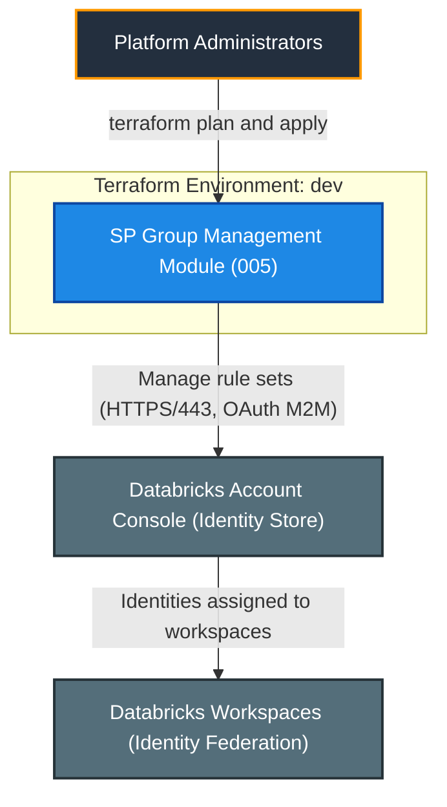
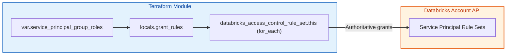
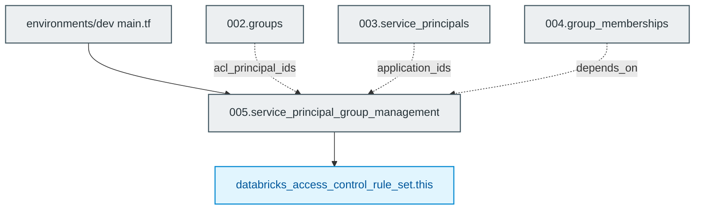

# Databricks Service Principal Group-Level Management Module (`005.service_principal_group_management`)

[](https://developer.hashicorp.com/terraform/docs)
[](https://registry.terraform.io/providers/databricks/databricks/latest/docs)
[](https://docs.databricks.com/aws/en/admin/users-groups/)

---

## 1. Executive Summary

- **Purpose & Scope**:
  Controls which groups may manage or use each service principal by managing one account-level `databricks_access_control_rule_set` per service principal, granting `roles/servicePrincipal.manager` and `roles/servicePrincipal.user` to groups.
- **Problem Statement & Solution**:
  Service principal access should be delegated to groups instead of individuals. This module expresses the delegation as service principal key => `managers` / `users` group keys, and builds the rule sets with `for_each` and a `dynamic` block.
- **Key Business & Security Outcomes**:
  - **Delegated administration**: Groups, not individuals, manage and use service principals.
  - **Referential integrity**: Preconditions reject unknown service principal keys and unknown group keys at plan time.
  - **Authoritative state**: The rule set is the single source of truth for grants on each service principal.

---

## 2. General Logic & Operational Flow

### 2.1 Configuration & Provisioning Lifecycle
1. **Input resolution**: Receives service principal application IDs, group ACL principal IDs and the role map.
2. **Grant calculation**: `locals.grant_rules` converts the `managers` and `users` group keys into ACL principals (`groups/<name>`), skipping empty roles.
3. **Resource creation**: `databricks_access_control_rule_set.this` uses `for_each` over service principals with a `dynamic "grant_rules"` block.
4. **Sequencing Guardrail**: In the root orchestration layer, this module is sequenced strictly after `004.group_memberships` using `depends_on` to ensure groups and members are fully replicated across the Databricks control plane before rule sets bind them.

### 2.2 Identity & Data Flow
- **Control flow**: Terraform -> Databricks Account Access Control API -> rule set `accounts/<account_id>/servicePrincipals/<application_id>/ruleSets/default`.
- **Roles**: `roles/servicePrincipal.manager` (manage the service principal, e.g. create secrets) and `roles/servicePrincipal.user` (use the service principal to run jobs).

---

## 3. Architecture of the Module

### 3.1 Resource Architecture & Attributes

| Resource | Cardinality | Key Attributes |
|:---|:---:|:---|
| `databricks_access_control_rule_set.this` | one per service principal | `name`, `grant_rules { role, principals }` |

### 3.2 Reference Usage
```hcl
module "service_principal_group_management" {
  source    = "../../modules/04.identity_management/005.service_principal_group_management"
  providers = { databricks = databricks.mws }

  account_id                        = var.databricks_account_id
  service_principal_application_ids = module.service_principals.application_ids
  group_acl_principal_ids           = module.groups.acl_principal_ids
  service_principal_group_roles = {
    etl = {
      managers = ["platform_admins"]
      users    = ["data_engineers"]
    }
  }

  depends_on = [
    module.group_memberships
  ]
}
```

### 3.3 Security, IAM & Encryption Posture
- **Authoritative resource**: the rule set overwrites existing grants on the service principal unless imported. Include every principal that must keep access.
- **Least privilege**: only the two documented service principal roles (manager, user) can be granted.
- **Scope**: requires the account-level provider and an account admin identity.

---

## 4. Architecture C4 Visualisation

### 4.1 Level 1: System Context Diagram


### 4.2 Level 2: Container / Infrastructure Diagram


### 4.3 Level 3: Component Diagram (Terraform Resource Orchestration)


---

## 5. All Modules Used with Short Summaries

### 5.1 Module Inventory Table

| Module Name | Source Path | Version / Ref | Primary Role / Responsibility |
|:---|:---|:---:|:---|
| `service_principal_group_management` | `modules/04.identity_management/005.service_principal_group_management` | `n/a` | Grants groups manager/user roles on service principals. |

This is a leaf module and does not invoke submodules. It consumes outputs from `002.groups` and `003.service_principals`, and in the root environment is sequenced after `004.group_memberships` via `depends_on` to eliminate eventual consistency race conditions between SCIM directory replication and Access Control rule set evaluation.

---

## 6. Terraform Documentation Interface

> [!NOTE]
> The full machine-generated Terraform interface (Providers, Modules, Inputs, Outputs, and Resource definitions) is maintained by `terraform-docs` via pre-commit hooks in [`TERRAFORM.md`](./TERRAFORM.md).
>
> Please refer directly to [`TERRAFORM.md`](./TERRAFORM.md) for detailed variable schemas, default values, and data structures.

### 6.1 Essential Inputs Summary

| Variable | Type | Description | Sample Value |
|:---|:---:|:---|:---|
| `account_id` | `string` | Databricks account ID (UUID) | `"00000000-0000-0000-0000-000000000000"` |
| `service_principal_application_ids` | `map(string)` | Service principal key => application ID | `module.service_principals.application_ids` |
| `group_acl_principal_ids` | `map(string)` | Group key => ACL principal ID | `module.groups.acl_principal_ids` |
| `service_principal_group_roles` | `map(object)` | Service principal key => `managers` / `users` group keys | `{ etl = { users = ["data_engineers"] } }` |

### 6.2 Essential Outputs Summary

| Output | Description | Downstream Consumer |
|:---|:---|:---|
| `rule_set_ids` | Map of service principal key => rule set ID | Reporting / auditing |

---

## 7. Important Links and Resources

- [databricks_access_control_rule_set resource](https://registry.terraform.io/providers/databricks/databricks/latest/docs/resources/access_control_rule_set) - Provider documentation for the managed resource.

### 7.1 Authoritative Databricks Documentation
- [Databricks on AWS Official Documentation](https://docs.databricks.com/aws/en/) - Core guide for Databricks on AWS.
- [Manage users, service principals, and groups](https://docs.databricks.com/aws/en/admin/users-groups/) - Identity management concepts for Databricks accounts.
- [Manage groups](https://docs.databricks.com/aws/en/admin/users-groups/groups) - Account groups and membership.
- [Manage service principals](https://docs.databricks.com/aws/en/admin/users-groups/service-principals) - Service principal roles (Manager, User) and management.
- [Databricks Terraform Provider Documentation](https://registry.terraform.io/providers/databricks/databricks/latest/docs) - Terraform registry provider guide for Databricks resources.

### 7.2 Terraform & Tooling Documentation
- [Terraform Language Documentation](https://developer.hashicorp.com/terraform/docs) - HCL syntax, expressions, and configuration concepts.
- [terraform-docs Documentation](https://terraform-docs.io/) - Automated interface generation tool used for [`TERRAFORM.md`](./TERRAFORM.md).

### 7.3 Internal Repository References
- [Project Instructions & Source of Truth](file:///.ai/instructions.md) - Architectural guidelines and coding standards.
- [Authoritative README Template](file:///.ai/README_TEMPLATE.md) - This template specification.
